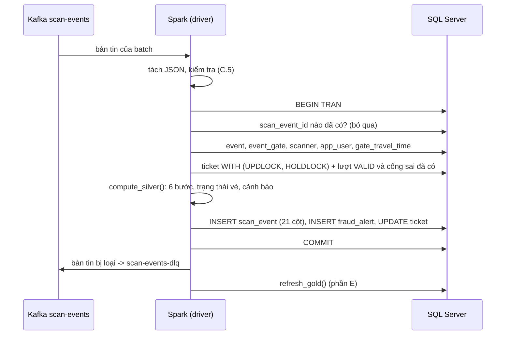

# 13 — Bronze & Silver Layer Specification (Design)

Tài liệu này đặc tả chi tiết kiến trúc lưu trữ, tổ chức thư mục tầng **Bronze** (Dữ liệu thô) và ma trận đối chiếu chuyển đổi sang bảng `SCAN_EVENT` tại tầng **Silver** (Dữ liệu đã qua xử lý nghiệp vụ) theo mô hình Medallion Architecture.

---

## Phần A. Tầng Bronze (Raw Scan Events)

Tầng Bronze có nhiệm vụ lưu trữ nguyên bản toàn bộ sự kiện quét vé được API đẩy vào Kafka topic `scan-events`. Dữ liệu tại đây mang tính bất biến (append-only), đóng vai trò là nhật ký kiểm toán (Audit Log) và nguồn gốc dữ liệu phục vụ đối soát, tra cứu hoặc replay luồng xử lý.

### 1. Bố cục cây thư mục và Phân vùng (Partitioning)

Dữ liệu được lưu trực tiếp trên hệ thống tệp tại môi trường WSL2. Thư mục được chia theo chiến lược phân vùng dạng Hive-partition, cụ thể là phân cấp theo **Ngày (`year`, `month`, `day`)** rồi đến **Giờ (`hour`)**. Mốc thời gian dùng để phân vùng bắt buộc phải là trường `received_at` (giờ API nhận request theo chuẩn giờ Việt Nam UTC+7).

**Cấu trúc thư mục mẫu:**
```text
data/bronze/scan_events/
└── year=2026/
    └── month=12/
        └── day=12/
            ├── hour=18/
            │   ├── part-00000-7f8b9a2c-1234-4567-89ab-cdef01234567.c000.snappy.parquet
            │   ├── part-00001-8e9c0b3d-2345-5678-9abc-def012345678.c000.snappy.parquet
            │   └── _SUCCESS
            ├── hour=19/
            │   ├── part-00000-9f0a1c4e-3456-6789-abcd-ef0123456789.c000.snappy.parquet
            │   └── _SUCCESS
            └── hour=20/
                ├── part-00000-b12c3e6a-5678-89ab-cdef-0123456789ab.c000.snappy.parquet
                └── _SUCCESS
```

### 2. Định dạng lưu trữ và Quy ước đặt tên tệp

- **Định dạng dữ liệu:** `Apache Parquet`.
- **Chuẩn nén:** `Snappy` (Tối ưu hóa tốc độ đọc/ghi cho Spark).
- **Quy ước đặt tên tệp:** Tệp do Spark Streaming sinh ra theo micro-batch phải tuân thủ cú pháp:
  `part-<partition_id:05d>-<random_uuid>.c<batch_id:03d>.snappy.parquet`
- **Tệp `_SUCCESS`:** Một tệp rỗng được sinh ra trong từng phân vùng giờ (`hour=...`) ngay khi batch ghi hoàn tất, báo hiệu dữ liệu trong thư mục đó đã sẵn sàng để đọc.

### 3. Cấu trúc trường dữ liệu Bronze

Dữ liệu tại tầng Bronze bảo toàn nguyên vẹn 9 trường Input từ đặc tả sự kiện quét thô:

| STT | Tên trường (Field Name) | Kiểu dữ liệu Spark | Bắt buộc | Nguồn sinh | Mô tả chi tiết |
|:---:|:---|:---|:---:|:---|:---|
| 1 | `scan_event_id` | `StringType` | Bắt buộc | API Gateway | UUID v4 định danh duy nhất cho một lượt quét (request API). Khóa định danh của event. |
| 2 | `raw_qr_payload` | `StringType` | Bắt buộc | Scanner | Chuỗi thô đọc trực tiếp từ QR code (bao gồm payload vé và HMAC). Không được rỗng. |
| 3 | `ticket_id` | `StringType` | Bắt buộc khi `decode_error = false`, NULL khi `= true` | Scanner | Mã vé được giải mã tại chỗ trên scanner. Nếu giải mã thất bại thì mang giá trị NULL. |
| 4 | `decode_error` | `BooleanType` | Bắt buộc | Scanner | Cờ báo lỗi giải mã (`true`: lỗi giải mã QR, `false`: giải mã thành công). |
| 5 | `gate_id` | `StringType` | Bắt buộc | Config thiết bị | Mã cổng thực hiện quét vé (`GATE_A`, `GATE_B`, `GATE_C`, `GATE_D`). |
| 6 | `scanner_id` | `StringType` | Bắt buộc | Config thiết bị | Mã thiết bị phần cứng thực hiện quét (`SC_A1`, `SC_B1`,...). Duy nhất theo máy. |
| 7 | `operator_id` | `StringType` | Tùy chọn (NULL) | Scanner / Session | Mã nhân viên soát vé (`user_id` trong `APP_USER`). Để trống/NULL nếu không yêu cầu login. |
| 8 | `scanned_at` | `TimestampType` | Bắt buộc | Scanner | Giờ ghi nhận trên máy quét (client clock, giờ Việt Nam UTC+7). Chỉ dùng hiển thị. |
| 9 | `received_at` | `TimestampType` | Bắt buộc | API Gateway | Giờ API nhận request (server clock, giờ Việt Nam UTC+7). Mốc chuẩn tính toán và phân vùng. |

---

## Phần B. Đối chiếu tầng Silver (Bảng `SCAN_EVENT`)

Tầng Silver nhận dữ liệu từ Kafka, Spark tính toán áp dụng luật nghiệp vụ (phát hiện gian lận, trừ thời gian, chuyển trạng thái vé) rồi ghi vào bảng `SCAN_EVENT` trên SQL Server. Bảng này có tổng cộng 25 cột.

Bảng dưới đây ánh xạ 1-1 từng trường của sự kiện với từng cột trong DB, phân rõ trách nhiệm sinh dữ liệu thuộc về luồng nào: **Chép nguyên**, **Spark tính ra**, hay **SQL Server tự tính**.

| STT | Trường dữ liệu (File 08) | Cột trong bảng `SCAN_EVENT` (File 12) | Cơ chế sinh dữ liệu | Chi tiết xử lý logic |
|:---:|:---|:---|:---|:---|
| **1** | `scan_event_id` | `scan_event_id` (PK) | **Chép nguyên** | Đẩy thẳng chuỗi UUID v4 từ API sinh. SQL Server tự động nhận diện dưới dạng kiểu `UNIQUEIDENTIFIER` 16-byte. |
| **2** | `raw_qr_payload` | `raw_qr_payload` | **Chép nguyên** | Bê nguyên chuỗi payload gốc của Bronze sang. |
| **3** | `ticket_id` | `ticket_id` (FK) | **Spark tính ra** | Lấy từ Bronze. **Tuy nhiên**, nếu mã vé không có thật trong bảng `TICKET`, thuộc sự kiện khác (`ACTIVE_EVENT_ID`), hoặc `decode_error = 1`, Spark bắt buộc gán thành `NULL` để không vi phạm khóa ngoại `FK_scan_event_ticket`. Mã gốc vẫn bảo toàn trong `raw_qr_payload`. |
| **4** | `decode_error` | `decode_error` | **Chép nguyên** | Lấy nguyên giá trị boolean của Bronze (SQL Server nhận giá trị 0 hoặc 1 của kiểu `BIT`). |
| **5** | `gate_id` | `gate_id` (FK) | **Chép nguyên** | Lấy nguyên mã cổng từ bản tin Bronze. |
| **6** | `scanner_id` | `scanner_id` (FK) | **Chép nguyên** | Lấy nguyên mã máy quét từ bản tin Bronze. |
| **7** | `operator_id` | `operator_id` (FK) | **Chép nguyên** | Lấy nguyên từ bản tin Bronze. Giữ nguyên `NULL` nếu máy quét không gửi mã nhân viên. |
| **8** | `scanned_at` | `scanned_at` | **Chép nguyên** | Giữ nguyên mốc thời gian máy quét đọc mã. |
| **9** | `received_at` | `received_at` | **Chép nguyên** | Giữ nguyên mốc thời gian hệ thống API tiếp nhận (UTC+7). |
| **10**| `processing_ts` | `processing_ts` | **Spark tính ra** | Spark chủ động đánh mốc thời gian khi batch xử lý hoàn tất sự kiện này (`processing_ts >= received_at`). |
| **11**| `ticket_status_before` | `ticket_status_before` | **Spark tính ra** | Spark đọc `ticket.ticket_status` ở DB (xem D.3). Trả về 1 trong 5 trạng thái vé trước khi bị quét. Trả `NULL` nếu không tìm thấy vé hợp lệ hoặc lỗi giải mã. |
| **12**| `ticket_status_after` | `ticket_status_after` | **Spark tính ra** | Spark xác định dựa trên `scan_result`. Đổi thành `VALID_ENTRY` nếu kết quả là `VALID`. Đổi thành `FLAGGED_FRAUD` nếu kết quả `USED` trên vé đang `VALID_ENTRY`. Còn lại chép y nguyên từ `ticket_status_before`. |
| **13**| `scan_result` | `scan_result` | **Spark tính ra** | Spark chạy qua 6 bước thứ tự ưu tiên (Precedence) để ra đúng 1 kết quả duy nhất: `VALID`, `INVALID`, `USED`, `CANCELLED`, `EXPIRED`, `WRONG_GATE`. |
| **14**| `alert_level` | `alert_level` | **Spark tính ra** | Spark map từ `scan_result` ra 1 trong 3 mức cảnh báo: `NONE`, `WARNING`, `FRAUD`. |
| **15**| `alert_code` | `alert_code` | **Spark tính ra** | Spark map ra mã cụ thể (`INVALID_QR`, `DUPLICATE_SCAN`, `IMPOSSIBLE_TRAVEL`, `REVOKED_TICKET`, `WRONG_GATE_WARNING`, `WRONG_GATE_FRAUD`). Gán `NULL` nếu `alert_level = NONE`. |
| **16**| `previous_scan_event_id` | `previous_scan_event_id` (FK) | **Spark tính ra** | Lấy UUID của lần quét hợp lệ gần nhất (trong `scan_event` ở DB, hoặc lượt VALID ngay trong batch, xem D.4). Bắt buộc có khi result là `USED`, ngược lại gán `NULL`. |
| **17**| `previous_scan_gate_id` | `previous_scan_gate_id` | **Spark tính ra** | Lấy mã cổng của lần quét hợp lệ trước (như dòng 16). Bắt buộc có khi result là `USED`, ngược lại gán `NULL`. |
| **18**| `time_since_previous_scan_ms` | `time_since_previous_scan_ms` | **Spark tính ra** | Spark tính bằng cách trừ hai mốc **`received_at`** (tuyệt đối không dùng `scanned_at`): `received_at (hiện tại) - received_at (lần quét trước)`. |
| **19**| `min_travel_time_ms` | `min_travel_time_ms` | **Spark tính ra** | Spark dò bảng dữ liệu thời gian đi bộ tối thiểu giữa cặp `gate_id` trước và hiện tại (`GATE_TRAVEL_TIME`). Gán `NULL` nếu cùng cổng hoặc dữ liệu cấu hình bị thiếu. |
| **20**| `ticket_assigned_gate_id` | `ticket_assigned_gate_id` | **Spark tính ra** | Spark gán ảnh chụp mã cổng được phân bổ của vé tra từ Master Data. Gán `NULL` nếu vé tự do không chỉ định cổng. |
| **21**| `distinct_wrong_gate_count` | `distinct_wrong_gate_count` | **Spark tính ra** | Spark đếm tích lũy (cổng sai đã có trong `scan_event` cộng cổng sai trong batch) số lượng cổng sai khác nhau. Bắt buộc có dữ liệu nếu result = `WRONG_GATE`. Tối đa bằng $N - 1$ cổng (với $N$ là số cổng mà sự kiện của vé mở trong bảng `EVENT_GATE`). |
| **22**| `is_duplicate` | `is_duplicate` (PERSISTED) | **SQL Server tự tính** | Cột tính toán lưu trữ. Công thức SQL: `CAST(CASE WHEN scan_result = 'USED' THEN 1 ELSE 0 END AS BIT)`. |
| **23**| `is_wrong_gate` | `is_wrong_gate` (PERSISTED) | **SQL Server tự tính** | Cột tính toán lưu trữ. Công thức SQL: `CAST(CASE WHEN scan_result = 'WRONG_GATE' THEN 1 ELSE 0 END AS BIT)`. |
| **24**| `fraud_alert` | `fraud_alert` (PERSISTED) | **SQL Server tự tính** | Cột tính toán lưu trữ. Công thức SQL: `CAST(CASE WHEN alert_level = 'FRAUD' THEN 1 ELSE 0 END AS BIT)`. Dùng để thống kê gian lận thật trên Dashboard. |
| **25**| `ingestion_lag_ms` | `ingestion_lag_ms` (PERSISTED) | **SQL Server tự tính** | Cột đo độ trễ pipeline. Công thức SQL: `DATEDIFF(MILLISECOND, received_at, processing_ts)`. |

---

## Phần C. Quy tắc tích hợp tầng Pipeline (Implementation Rules)

1. **Giới hạn số cột khi ghi JDBC:**
   - Bảng `SCAN_EVENT` có tổng cộng **25 cột**.
   - Có **4 cột tự tính bởi SQL Server** (`is_wrong_gate`, `is_duplicate`, `fraud_alert`, `ingestion_lag_ms`) được định nghĩa là **Computed PERSISTED Columns** ở cấp độ Database.
   - Do đó, câu ghi của Spark **tuyệt đối chỉ liệt kê 21 cột**. Bất kỳ nỗ lực nào chèn giá trị (kể cả truyền `NULL`) vào 4 cột tính toán này sẽ khiến SQL Server ném lỗi từ chối Transaction ngay lập tức.
   - Spark **không** dùng `df.write.jdbc`: mỗi lần gọi là một kết nối và một giao dịch riêng, nên không ghi được `scan_event`, `fraud_alert` và `ticket` trong cùng một giao dịch như mục 3. Driver Spark tự mở một kết nối JDBC và ghi bằng `INSERT … SELECT … FROM OPENJSON(?)`. Cả batch là một tham số JSON nên không ghép chuỗi SQL. Chi tiết ở phần D.
2. **Xử lý toàn vẹn dữ liệu ngoại lệ cho `ticket_id`:**
   - Trong bản tin thô Bronze, `ticket_id` có thể chứa mã vé không tồn tại trong DB, vé của sự kiện khác, hoặc bị lỗi giải mã do đọc QR hỏng.
   - Khi chuyển sang Silver, để không vi phạm ràng buộc khóa ngoại `FK_scan_event_ticket`, Spark bắt buộc phải lọc và gán `ticket_id = NULL` đối với các trường hợp ngoại lệ này.
   - Lịch sử mã quét lỗi vẫn luôn được bảo toàn nguyên vẹn tại cột `raw_qr_payload`.
3. **Đồng bộ hóa bảng `FRAUD_ALERT`:**
   - Đối với các bản tin có `alert_level` khác `NONE` (`WARNING` hoặc `FRAUD`), Spark phải thực hiện ghi đồng thời bản ghi sự kiện vào `SCAN_EVENT` và chi tiết cảnh báo vào bảng thực thể yếu `FRAUD_ALERT` trong **cùng một giao dịch (Transaction)** để đảm bảo tính nhất quán dữ liệu tuyệt đối.
4. **Xử lý bản tin lỗi schema (Dead Letter Queue - DLQ):**
   - Các bản tin đẩy lên Kafka bị lỗi cấu trúc định dạng JSON (malformed payload) hoặc thiếu các trường bắt buộc (`scan_event_id`, `raw_qr_payload`, `received_at`) sẽ được chuyển hướng trực tiếp sang topic `scan-events-dlq`, không ghi xuống tầng Bronze hay Silver.
5. **Bản tin vào được Bronze nhưng không ghi được Silver:**
   - Một số bản tin hợp lệ ở mức Bronze nhưng sẽ vi phạm khóa ngoại, NOT NULL hoặc CHECK của `scan_event`. Nếu để chúng đi tiếp, cả giao dịch của batch bị từ chối và Spark kẹt mãi ở batch đó. Vì vậy Spark chặn trước và gửi sang `scan-events-dlq`, kèm hai header Kafka: `dlq_stage = silver` và `dlq_reason` mang một trong các mã dưới đây.
   - Bản tin của API đã qua kiểm tra (file 15 mục 2.1) nên bình thường không rơi vào đây. Đường này chủ yếu bắt bản tin gửi thẳng vào Kafka.

   | `dlq_reason` | Khi nào |
   |---|---|
   | `BAD_SCAN_EVENT_ID` | `scan_event_id` không phải UUID (cột `UNIQUEIDENTIFIER`) |
   | `MISSING_DECODE_ERROR`, `MISSING_GATE_OR_SCANNER`, `BAD_SCANNED_AT` | Thiếu trường NOT NULL hoặc giờ hỏng |
   | `ID_TOO_LONG`, `PAYLOAD_TOO_LONG` | Mã dài quá 20 ký tự, payload dài quá 512 ký tự |
   | `RECEIVED_AT_IN_FUTURE` | `received_at` vượt giờ Spark quá 2 giây (`CK_scan_event_ts`) |
   | `UNKNOWN_SCANNER_GATE` | Cặp `(scanner_id, gate_id)` không có trong `scanner` (`FK_scan_event_scanner`) |
   | `UNKNOWN_OPERATOR` | `operator_id` không phải `GATE_OPERATOR` có trong `app_user` |
   | `INCONSISTENT_TICKET_STATE` | Vé đang `VALID_ENTRY`/`FLAGGED_FRAUD` nhưng DB không có lượt `VALID` nào để trỏ về (`CK_scan_event_used`). Chỉ xảy ra khi có người sửa tay `ticket_status` |
   | `SQL_ERROR_<mã>` | SQL Server vẫn từ chối dù đã kiểm tra trước. Spark xử lý lại từng vé một để chỉ loại đúng bản tin hỏng |

---

## Phần D. Job Silver (cài đặt của Role B)

### D.1 Các tệp

| Tệp | Nội dung |
|---|---|
| `spark/stream_scan_events.py` | Một tiến trình, một SparkSession, hai streaming query độc lập: `bronze` (5 giây/batch) và `silver` (1 giây/batch). Mỗi query một checkpoint, nên query này lỗi thì query kia vẫn chạy. Query lỗi được bật lại tối đa 5 lần |
| `spark/silver_scan_events.py` | Việc của một micro-batch Silver: kiểm tra bản tin, giao dịch SQL Server, DLQ, gọi Gold |
| `spark/silver_logic.py` | Luật nghiệp vụ (6 bước của file 07, trạng thái vé của file 06, R1–R4 của file 09) viết bằng DataFrame, không đụng Kafka hay DB |
| `spark/sqlserver.py` | Kết nối JDBC tự quản giao dịch. Driver `mssql-jdbc` nạp qua `spark.jars.packages`, giống connector Kafka |
| `spark/gold.py` | Chỗ nối sang Gold (phần E), Role A viết thân hàm |
| `spark/run_pipeline.sh` | Chạy pipeline bằng `.venv` và Java 21. `scripts/up.sh stream` gọi tệp này |

### D.2 Một micro-batch Silver làm gì



### D.3 Trạng thái vé lấy từ đâu

Spark đọc thẳng từ DB ở mỗi batch (`ticket.ticket_status`, lượt `VALID` và các cổng `WRONG_GATE` đã có trong `scan_event`), **không** giữ trong state store của Spark. Lý do: API cũng đổi trạng thái vé (thu hồi, file 15 mục 3.5). Nếu Spark giữ bản riêng thì sẽ không thấy vé vừa bị thu hồi. Khóa `UPDLOCK, HOLDLOCK` giữ các vé của batch tới lúc COMMIT. Vì thế câu `UPDATE … WHERE ticket_status = 'UNUSED'` của API phải chờ, và không có chuyện vừa thu hồi xong thì Spark lại cho vào.

### D.4 Thứ tự xử lý trong một batch

Các lượt quét của cùng một vé được xử lý lần lượt theo `received_at`. Hai lượt cùng mili giây thì xếp theo `partition` rồi `offset` của Kafka (cùng vé thì cùng partition, vì khóa là `ticket_id`). Lượt sau thấy trạng thái mà lượt trước để lại. Ví dụ hai lượt `TK001` trong cùng batch ra `VALID` rồi `USED`, và lượt `USED` trỏ `previous_scan_event_id` về lượt `VALID` ngay trong batch đó. Trong `silver_logic.py` việc này làm bằng hàm cửa sổ (`Window.partitionBy(ticket)`), không gom về driver.

### D.5 Tắt giữa chừng không trùng, không mất

- Mọi thao tác ghi của một batch nằm trong một giao dịch. Batch chưa COMMIT mà Spark chết thì không có gì được ghi. Khi bật lại, Spark đọc lại đúng các offset đó từ checkpoint.
- Batch đã COMMIT nhưng Spark chết trước khi kịp ghi checkpoint thì batch chạy lại sẽ thấy mọi `scan_event_id` đã có, nên bỏ qua hết. PK của `scan_event` là chốt chặn cuối.
- Kiểm chứng: `scripts/test_silver_restart.sh` (`kill -9` giữa chừng, gửi tiếp lúc Spark tắt, rồi bật lại).

### D.6 Các quyết định chi tiết

| Chỗ tài liệu chưa nói rõ | Chọn |
|---|---|
| `ticket_status_before/after` của lượt `INVALID` | `NULL` cả hai, kể cả vé có thật của sự kiện khác, vì `ticket_id` đã bị gán `NULL` |
| Ranh giới giờ nhận khách | Tính cả `admission_start`, không tính `admission_end`: quét lúc 20:00:00.000 là `EXPIRED` |
| So khớp mã vé | Phân biệt hoa thường: `tk001` ra `INVALID`, dù collation CI của DB coi là `TK001` (file 15 mục 0 cũng từ chối chữ thường) |
| `previous_scan_event_id` của lượt quét thứ ba trở đi | Vẫn trỏ về lượt `VALID` duy nhất của vé (file 08: "lần quét hợp lệ trước đó"), R4 cũng đo từ lượt đó |
| `distinct_wrong_gate_count` | Chỉ ghi khi `WRONG_GATE`. Không bao giờ tính cổng đang được gán của vé. Ngưỡng FRAUD viết `>= N − 1` để khỏi lọt khi có cổng ngoài sự kiện |
| `ticket_assigned_gate_id` | Ghi cho mọi vé tra được, không riêng `WRONG_GATE`. API tự che theo `scan_result` (file 15 mục 1.1) |
| `time_since_previous_scan_ms` | Trị tuyệt đối của hiệu hai `received_at`, phòng khi hai lượt cùng vé tới Kafka ngược thứ tự ở hai batch khác nhau |
| `processing_ts` | Giờ Spark ngay trước khi ghi. Nếu nhỏ hơn `received_at` vài ms do lệch đồng hồ thì lấy bằng `received_at` |
| Chữ ký HMAC của QR | Đã chốt ở file 15 ("Định dạng mã QR và cách ký"): **API** kiểm chữ ký trong `POST /scan`. Chữ ký sai thì API gửi `decode_error = true`, `ticket_id = null`, nên Spark ra `INVALID` / `INVALID_QR` ở bước 1. Spark **không** kiểm lại chữ ký và không cần `QR_HMAC_SECRET` (secret chỉ nằm ở API). `raw_qr_payload` được chép nguyên văn, kể cả chuỗi sai chữ ký, để người giám sát xem lại |

### D.7 Chạy và kiểm thử

```bash
.venv/bin/python spark/tests/test_silver_logic.py   # luật Silver, không cần Docker (39 ca, có TC01-TC08)
./scripts/up.sh stream                              # SQL Server + Kafka + pipeline Spark
./scripts/test_silver.sh                            # đầu-cuối: đủ 6 kết quả, cùng batch, khác batch
./scripts/test_silver_restart.sh                    # kill -9 giữa chừng rồi bật lại
./scripts/measure_ingestion_lag.sh                  # đo ingestion_lag_ms của 100 lượt -> docs/
```

Thử trước ngày demo: CHECK `processing_ts >= received_at` không cho ghi lượt quét có giờ nhận ở tương lai. Vì vậy `./scripts/dev_event_window.sh now` dời khung giờ của `ACTIVE_EVENT_ID` về quanh hiện tại, còn `scripts/send_scans.py VÉ@CỔNG@-GIÂY` gửi giờ nhận tính lùi từ bây giờ. Xong việc thì `./scripts/dev_event_window.sh demo` để trả lại giờ demo.

`send_scans.py` ký chuỗi QR đúng như API (file 15, đã đối chiếu với `crypto.createHmac` của Node). `FORGED:<mã>` giả một QR sai chữ ký: script gửi đúng bản tin mà API sẽ gửi khi kiểm chữ ký thất bại. `--qr <mã>` chỉ in chuỗi QR đã ký, dùng để in vé thử khi chưa có `GET /api/tickets/:id/qr`. Gửi thẳng vào Kafka là bỏ qua bước kiểm chữ ký của API, nên chỉ dùng để thử. Chặn việc ghi thẳng vào Kafka là phần bảo mật ở Phase 8.

---

## Phần E. Nối Silver với Gold (thỏa thuận B và A)

| Hạng mục | Thỏa thuận |
|---|---|
| Ai gọi | Job Silver gọi `refresh_gold(db, event_id, batch_id)` trong `spark/gold.py` |
| Khi nào | Ngay sau mỗi micro-batch Silver đã COMMIT. Thêm một lần lúc pipeline khởi động (`batch_id = None`). Batch rỗng chỉ gọi nếu lần trước Gold lỗi |
| Ai viết | Role A viết thân hàm. Role B không viết logic Gold |
| Đầu vào | Chỉ đọc `scan_event` (và `fraud_alert`, `event`, `event_gate`). `event_id = ACTIVE_EVENT_ID`. `scan_event` không có cột `event_id` nên mọi dòng đều tính cho sự kiện đang chạy (file 15 mục 7.1) |
| Cách tính | **Tính lại** cả 3 bảng của file 14 từ Silver, không cộng dồn. Gọi hai lần liên tiếp ra cùng kết quả. Spark có thể gọi lại sau khi khởi động lại hoặc sau một batch đã ghi rồi, nên cộng dồn sẽ đếm trùng |
| Giao dịch | Hàm tự mở: `with db.transaction(): db.execute(sql, tham_so_chuoi, …)`. Kết nối dùng chung với Silver, mọi tham số là chuỗi `NVARCHAR` |
| Lỗi | Hàm ném lỗi thì Silver ghi log rồi gọi lại ở batch sau. Silver **không** dừng vì Gold. Silver đã COMMIT trước nên không mất gì |
| Độ trễ | Gold chậm hơn Silver đúng thời gian một lần `refresh_gold`. `POST /scan` của API đọc `scan_event` (Silver), không đọc Gold, nên không bị ảnh hưởng |

Cần sửa ở chỗ khác cho khớp thỏa thuận (việc của A):

- File 14 mục 3 đang ghi "MERGE cộng dồn" và mục 1.3 ghi `gold_alert` nằm cùng giao dịch với `scan_event`. Theo thỏa thuận này thì `gold_alert` do `refresh_gold()` bù ngay sau COMMIT, và cả 3 bảng được tính lại.
- `database/reset_test_data.sql` phải xóa `gold_alert` **trước** `scan_event` (có `FK_gold_alert_scan_event`), và xóa luôn `gold_gate_stats`, `gold_event_stats`.
