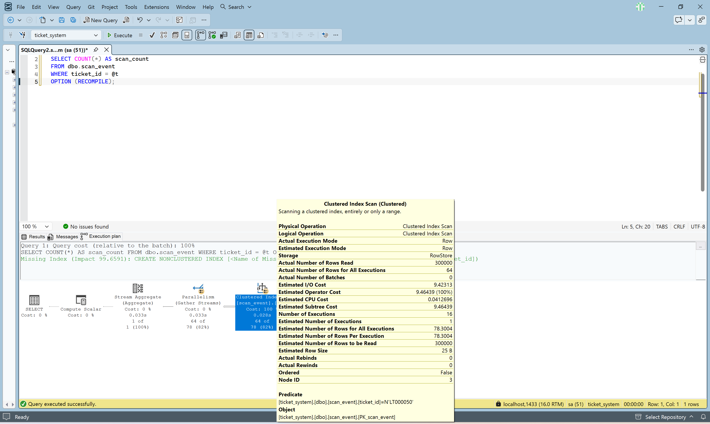
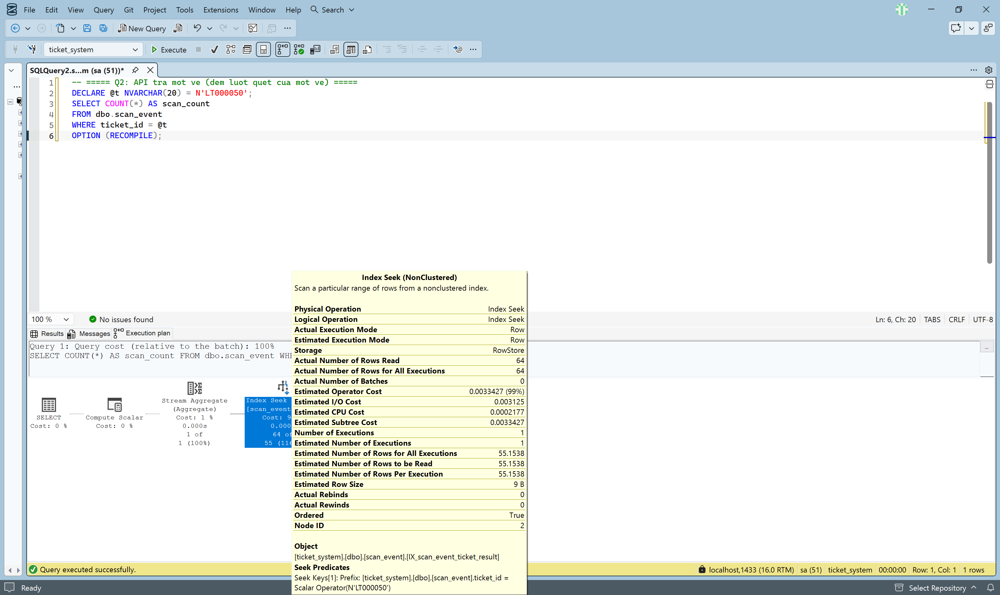
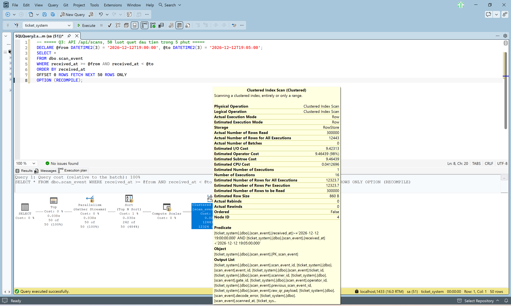
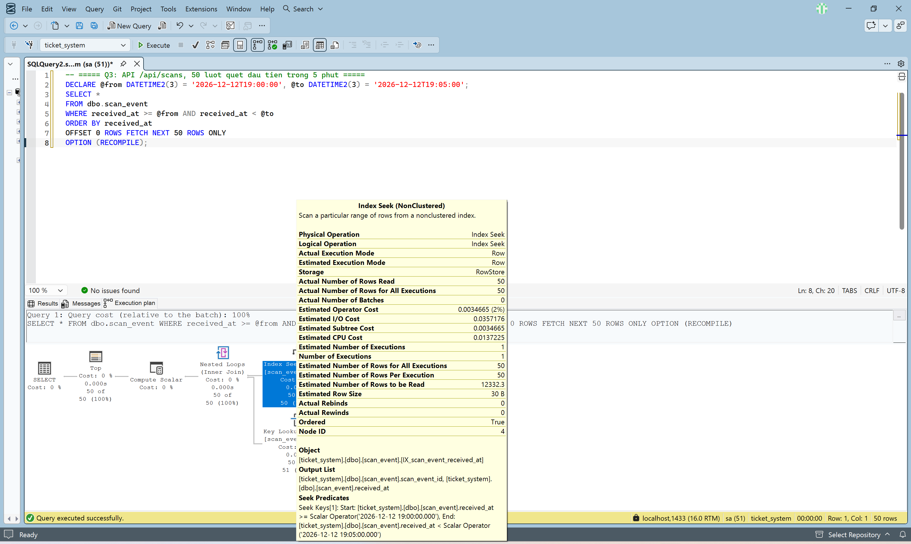
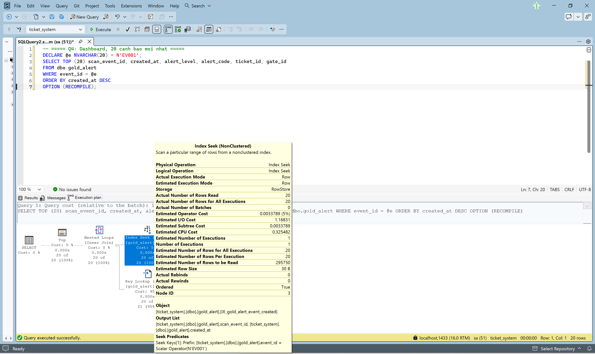
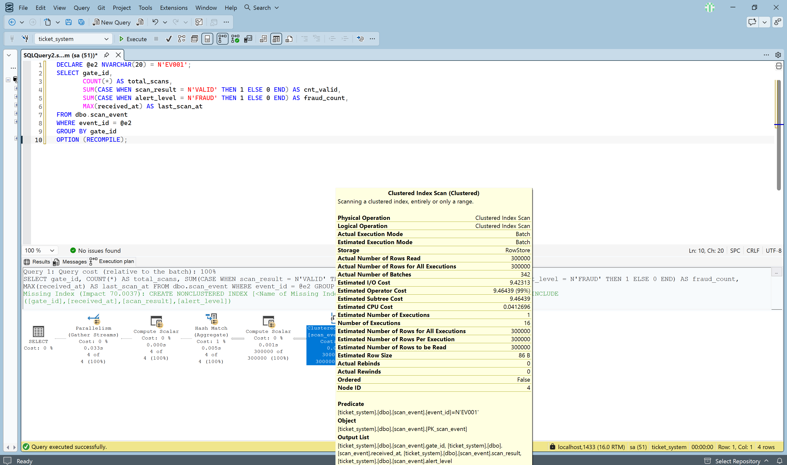
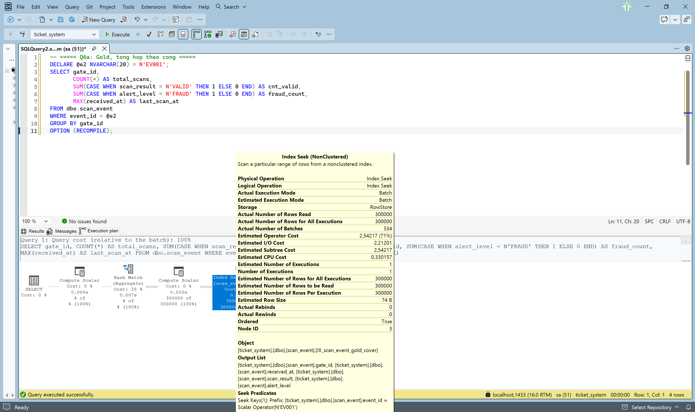

# Báo cáo Index (A3)

Đo hiệu năng truy vấn trước và sau khi tạo index trên bộ dữ liệu 300.000 dòng `scan_event`.

## 1. Môi trường và dữ liệu

| | |
|---|---|
| CSDL | SQL Server 2022 (`mcr.microsoft.com/mssql/server:2022-latest`) chạy trong Docker trên WSL2 |
| Dữ liệu | 5.000 vé tải (tiền tố `LT`, cộng 7 vé seed = 5.007 dòng `ticket`), 300.000 dòng `scan_event`, 295.750 dòng `gold_alert` |
| Sinh dữ liệu | `database/generate_load_data.sql`, chạy thật, mất 21,8 giây |
| Kiểm tra toàn vẹn | `database/check.sql` trả **0 dòng lỗi** ở cả 8 câu kiểm tra (gồm đối chiếu Gold với Silver) |
| Khung giờ | Mọi lượt quét tải nằm trong 18:00–20:00; dòng "scan_event ngoai khung gio" bằng **0** |
| Điều kiện đo | Spark đã dừng, không có tải khác. Mỗi truy vấn chạy 2 lượt: lượt 1 xóa cache (`DBCC DROPCLEANBUFFERS`), lượt 2 cache nóng |
| Công cụ | `SET STATISTICS IO, TIME ON`; script `database/measure_indexes.sql` |

Phân bố kết quả quét của bộ dữ liệu tải: `USED` 246.662, `INVALID` 38.590, `CANCELLED` 9.273, `VALID` 4.250, `WRONG_GATE` 1.225.

**Lưu ý kỹ thuật.** Bản SQL Server trên Linux trong Docker báo `Msg 17750` khi gọi `EXEC sp_executesql`, nên
`measure_indexes.sql` chạy các truy vấn trực tiếp, kèm `OPTION (RECOMPILE)` để optimizer thấy giá trị thật của biến (giống
tham số khi API gọi). Thời gian chỉ vài mili giây nên dao động mỗi lần đo; chỉ số đáng tin nhất là **logical reads**.

## 2. Năm index

| Index | Bảng | Khóa (INCLUDE) | Kích thước |
|---|---|---|---|
| `IX_scan_event_ticket_result` | `scan_event` | `(ticket_id, scan_result)` (`gate_id`, `received_at`) | 21,47 MB |
| `IX_scan_event_received_at` | `scan_event` | `(received_at)` | 8,70 MB |
| `IX_scan_event_gold_cover` | `scan_event` | `(event_id)` (`gate_id`, `scan_result`, `alert_level`, `received_at`) | 23,44 MB |
| `IX_ticket_event_status` | `ticket` | `(event_id, ticket_status)` | 0,33 MB |
| `IX_gold_alert_event_created` | `gold_alert` | `(event_id, created_at DESC)` | 12,38 MB |

Tổng 66,32 MB. Để so sánh: `PK_scan_event` 100,04 MB, `PK_gold_alert` 54,32 MB, `PK_ticket` 0,41 MB. Ba index trên
`scan_event` chiếm 53,61 MB, tức hơn một nửa dung lượng bảng.

Cả năm index đã được chép vào `database/init.sql` theo kiểu `IF NOT EXISTS`, nên DB dựng mới đều có sẵn.

## 3. Kết quả trước/sau (cache lạnh / cache nóng)

"Trước" là khi chỉ còn khóa chính (`indexes_drop.sql`), "sau" là khi đã có đủ năm index (`indexes.sql`).
Logical reads cộng tất cả bảng của truy vấn đó nằm trong cột Logical reads, trừ khi ghi chú.

| Truy vấn | Index giúp | Logical reads (trước → sau) | Elapsed lạnh (ms) | Elapsed nóng (ms) |
|---|---|---|---|---|
| **Q1** Spark: lượt VALID và cổng sai của 50 vé | `IX_scan_event_ticket_result` | `scan_event` 13.485 → 302 (-97,8%) | 68 → 3 | 32 → 0 |
| **Q2** API tra một vé (3 câu lệnh) | `IX_scan_event_ticket_result` | 40.455 (3 × 13.485) → 11 (4 + 3 + 4) (-99,97%) | 101 → 1 | 80 → 0 |
| **Q3** API lọc 50 lượt quét theo khoảng thời gian | `IX_scan_event_received_at` | 13.485 → 4 (-99,97%) | 50 → 2 | 35 → 0 |
| **Q4** Dashboard: 20 cảnh báo mới nhất | `IX_gold_alert_event_created` | `gold_alert` 7.321 → 3 (-99,96%) | 30 → 1 | 19 → 0 |
| **Q5** Dashboard: đếm vé theo trạng thái | `IX_ticket_event_status` | `ticket` 52 → 42 (-19%) | 3 → 2 | 3 → 0 |
| **Q6a** Gold: tổng hợp theo cổng | `IX_scan_event_gold_cover` | 13.485 → 3.000 (-77,8%); CPU 188 → 85 ms | 48 → 86 | 29 → 73 |
| **Q6b** `usp_refresh_gold` (cả thủ tục) | `IX_scan_event_gold_cover`, `IX_gold_alert_event_created` | `scan_event` 40.462 → 19.646 (-51,4%); `gold_alert` 7.321 → 1.667 (-77,2%) | 291 → 380 | 161 → 240 |

Ghi chú:
- Q2 cộng ba câu: đếm lượt quét, lượt VALID đầu tiên, lượt quét mới nhất.
- Q6b: số liệu cộng của ba câu `INSERT` bên trong thủ tục (`gold_gate_stats`, `gold_event_stats`, `gold_alert`); thời gian là của cả thủ tục.

### Kế hoạch thực thi

Kế hoạch thực tế (Actual Execution Plan) chụp từ SQL Server Management Studio, trước và sau khi tạo index.
Mỗi ảnh có câu truy vấn, sơ đồ kế hoạch và khung chú thích của toán tử truy cập dữ liệu (tên đối tượng, điều kiện, số dòng đã đọc).

| Truy vấn | Trước (chỉ có khóa chính) | Sau (đủ năm index) |
|---|---|---|
| **Q2** tra một vé |  |  |
| **Q3** 50 lượt quét theo khoảng thời gian |  |  |
| **Q4** 20 cảnh báo mới nhất |  |  |
| **Q6a** Gold tổng hợp theo cổng |  |  |

Số liệu đọc từ khung chú thích của các ảnh:

| Truy vấn | Trước: toán tử, số dòng phải đọc | Sau: toán tử, số dòng đã đọc | Chi phí ước tính của toán tử truy cập (trước → sau) |
|---|---|---|---|
| Q2 | `Clustered Index Scan` `PK_scan_event`: đọc **300.000** dòng để trả 64 | `Index Seek` `IX_scan_event_ticket_result`: đọc **64** dòng | 9,46 → 0,0033 |
| Q3 | `Clustered Index Scan` `PK_scan_event`: đọc **300.000** dòng, 12.443 dòng khớp rồi `Top N Sort` để lấy 50 | `Index Seek` `IX_scan_event_received_at`: đọc **50** dòng, kèm `Key Lookup` 50 dòng; **hết** `Sort` và `Parallelism` | 9,46 → 0,0035 |
| Q4 | `Clustered Index Scan` `PK_gold_alert`: đọc **295.750** dòng rồi `Top N Sort` (chiếm **63%** chi phí) để lấy 20 | `Index Seek` `IX_gold_alert_event_created`: đọc **20** dòng, kèm `Key Lookup` 20 dòng; **hết** `Sort` và `Parallelism` | 5,16 → 0,0034 |
| Q6a | `Clustered Index Scan` `PK_scan_event`: đọc **300.000** dòng, có `Parallelism (Gather Streams)` | `Index Seek` `IX_scan_event_gold_cover`: vẫn đọc **300.000** dòng nhưng trong index hẹp, không cần quay lại bảng gốc; **không còn** `Parallelism` | 9,46 → 2,54 (-73%) |

Ghi chú:
- SSMS tự gợi ý (dòng `Missing Index` màu xanh trong ảnh "trước") đúng các index nhóm đã tạo: Q2 gợi ý index theo `ticket_id` (Impact 99,66%);
  Q6a gợi ý index theo `event_id` kèm `INCLUDE (gate_id, received_at, scan_result, alert_level)` (Impact 70%), trùng với `IX_scan_event_gold_cover`.
- Q3 và Q4 có thêm bước `Key Lookup` vì câu của API lấy đủ cột (`SELECT *`, hoặc nhiều cột của `gold_alert`) mà index không chứa hết; chỉ 50 và 20 lookup nên chi phí vẫn rất nhỏ.
  Câu đo `logical reads` ở mục 3 bọc trong `COUNT(*)` nên không có bước lookup.
- Q6a: `event_id = 'EV001'` khớp mọi dòng của bộ dữ liệu tải nên dù dùng `Index Seek` vẫn đọc cả index (khoảng 3.000 trang); lợi ích đến từ việc index hẹp hơn bảng gốc (13.485 trang).
  Việc kế hoạch "sau" không còn `Parallelism` khớp với kết quả đo ở mục 3: thời gian chờ của Q6a tăng dù đọc ít trang hơn.
- Chi phí ước tính là đơn vị tương đối của optimizer, không phải mili giây; thời gian chạy thật nằm ở mục 3.

## 4. Vì sao từng index giúp

- **`IX_scan_event_ticket_result`** (Q1, Q2). Cả hai truy vấn lọc theo `ticket_id`, Q1 còn lọc thêm `scan_result`. Khóa `(ticket_id, scan_result)`
  cho phép nhảy thẳng tới các dòng của vé cần tìm; `INCLUDE (gate_id, received_at)` chứa sẵn các cột được chọn và sắp xếp nên
  không cần quay lại bảng gốc. Mỗi vé chỉ có khoảng 64 lượt quét nên mỗi câu đọc 3 đến 4 trang thay vì cả bảng 13.485 trang.
  Với Q1 (50 vé) Spark chạy 100 lần seek, tổng 302 trang.
- **`IX_scan_event_received_at`** (Q3). Truy vấn lấy 50 dòng đầu trong khoảng 5 phút và sắp xếp theo `received_at`. Index theo `received_at` vừa tìm khoảng
  thời gian vừa cho sẵn thứ tự, nên SQL Server đọc đúng 50 dòng đầu rồi dừng, không phải quét 300.000 dòng và sắp xếp.
  Khi API lấy đủ cột (`SELECT *`), 50 dòng đó được lấy nốt bằng key lookup, vẫn rất rẻ.
- **`IX_gold_alert_event_created`** (Q4). Dashboard luôn hỏi "20 cảnh báo mới nhất của sự kiện". Khóa `(event_id, created_at DESC)` đã sắp sẵn
  theo đúng thứ tự cần hiển thị, nên chỉ đọc 3 trang đầu thay vì 7.321 trang. Các cột còn lại của 20 dòng đó lấy bằng key lookup.
- **`IX_ticket_event_status`** (Q5). Truy vấn đếm vé theo trạng thái của một sự kiện. Index theo `(event_id, ticket_status)` phủ toàn bộ cột cần dùng
  nên đọc ít trang hơn và bỏ bước tạo bảng tạm để gom nhóm (hết `Worktable`/`Workfile`). Bảng `ticket` chỉ 0,41 MB (khoảng 5.000 dòng) nên lợi ích
  nhỏ (52 → 42 trang). Ý nghĩa chính là giữ cho truy vấn không phình ra khi số vé tăng lên.
- **`IX_scan_event_gold_cover`** (Q6a, Q6b). Gold cần cộng dồn theo cổng với `scan_result`, `alert_level`, `received_at`. Index khóa `(event_id)` kèm `INCLUDE` đúng các cột đó là
  index phủ: truy vấn đọc index (3.000 trang) thay vì bảng gốc (13.485 trang), CPU giảm từ 188 xuống 85 ms.

### Một kết quả không như kỳ vọng: Q6a và Q6b chậm hơn về thời gian chờ

Dù Q6a đọc ít trang hơn 78% và dùng ít CPU hơn một nửa, thời gian chờ thực lại tăng (48 → 86 ms lạnh, 29 → 73 ms nóng); với Q6b tăng
291 → 380 ms (lạnh) và 161 → 240 ms (nóng). Nguyên nhân thấy được từ số liệu:

- Trước khi có index, SQL Server quét bảng gốc bằng **kế hoạch song song** (scan count 17: CPU 188 ms dồn vào 48 ms thực).
- Sau khi có index phủ, nó chọn **kế hoạch tuần tự** trên một index hẹp (scan count 1), chạy một luồng nên thời gian chờ dài hơn dù tổng công việc ít hơn.
- Ở quy mô 300.000 dòng và toàn bộ dữ liệu nằm trong RAM, chạy song song nhanh hơn về đồng hồ. Phần lợi của index phủ nằm ở **I/O và CPU**: ít trang cần đọc,
  ít bộ đệm bị chiếm, nên có giá trị khi dữ liệu lớn hơn bộ nhớ hoặc khi nhiều truy vấn chạy đồng thời (Spark gọi Gold sau mỗi lô).
- Câu `INSERT INTO gold_alert` trong `usp_refresh_gold` vẫn đọc `scan_event` 13.492 trang dù đã có index, vì điều kiện `alert_level <> 'NONE'` cùng phép
  `NOT EXISTS` không dùng được `IX_scan_event_gold_cover`. Đây là điểm có thể tối ưu thêm (ví dụ index lọc cho `alert_level <> 'NONE'`), ngoài phạm vi của đợt này.

Kết luận thực tế: các index tra cứu theo khóa (Q1–Q4) cho lợi ích rất lớn và ổn định; index phủ cho Gold giảm tải I/O và CPU
nhưng không làm Gold nhanh hơn về thời gian chờ ở quy mô thử nghiệm này.

## 5. Hai index thử nghiệm không giúp được

Tạo bằng `database/indexes_experiment.sql`, đo lại bằng cùng script. Nền so sánh là kết quả "sau" ở mục 3 (đã có năm index chính thức).

| Truy vấn | Index thử | Logical reads (không có → có) | Elapsed lạnh/nóng (ms) | Kế hoạch dùng index? |
|---|---|---|---|---|
| **X1** `MAX(processing_ts) ... WHERE gate_id = 'GATE_A'` | `IX_exp_scan_event_gate` trên `scan_event(gate_id)` (11,13 MB) | 13.485 → 13.485 (không đổi) | 51/21 → 51/23 | Không: số trang đọc vẫn bằng quét cả bảng, scan count 17 |
| **X2** đếm `app_user` theo `role` | `IX_exp_app_user_role` trên `app_user(role)` (0,02 MB) | 2 → 2 (không đổi) | 1/0 → 0/0 | Không có lợi ích đo được (cả bảng chỉ 2 trang) |

Kết luận: cả hai index **không làm giảm một trang nào**; chênh lệch vài mili giây (51/21 → 51/23 ms; 1/0 → 0/0 ms) là dao động đo, không phải cải thiện.

Lý do hai index này không đáng giữ:

- **`IX_exp_scan_event_gate`**. Chỉ có 4 cổng nên mỗi giá trị `gate_id` chiếm khoảng 25% dòng (độ chọn lọc rất thấp). Truy vấn còn cần cột `processing_ts` không nằm trong index,
  nên nếu dùng index, SQL Server phải tra ngược về bảng gốc cho khoảng 75.000 dòng, đắt hơn việc quét một lần. Do đó optimizer vẫn quét bảng (13.485 trang).
  Số đo xác nhận điều này: X1 vẫn đọc 13.485 trang với scan count 17, giống hệt khi chưa có index. Index tốn thêm 11,13 MB và làm chậm mỗi lần Spark ghi `scan_event`,
  mà không có truy vấn nào của hệ thống hưởng lợi.
- **`IX_exp_app_user_role`**. Bảng `app_user` chỉ có vài dòng, nằm gọn trong 1 đến 2 trang (0,02 MB). Đọc cả bảng chỉ tốn 2 lượt đọc, không có gì để tiết kiệm;
  index chỉ thêm việc bảo trì. Số đo xác nhận: X2 vẫn 2 lượt đọc trước và sau khi tạo index.

Quy tắc rút ra: index chỉ có ích khi cột lọc **chọn lọc** (ít dòng khớp) hoặc khi nó phục vụ đúng thứ tự/cột mà truy vấn cần (index phủ); bảng quá nhỏ hoặc cột ít giá trị
phân biệt thì quét bảng rẻ hơn.

Sau khi đo, hai index thử đã được xóa (`indexes_drop.sql` rồi `indexes.sql`), `init.sql` không chứa chúng.

## 6. Chi phí

- **Dung lượng:** thêm 66,32 MB cho năm index (mục 2); riêng `scan_event` thêm 53,61 MB trên bảng 100,04 MB.
- **Ghi:** mỗi lượt quét Spark ghi vào `scan_event` phải cập nhật thêm 3 index của bảng này (và `gold_alert`, `ticket` khi có thay đổi). Chưa đo riêng chi phí
  ghi trong đợt này; đo độ trễ ghi của hệ thống thực nằm ở `docs/performance.md`.

## 7. Cách chạy lại

Đứng ở gốc repo, `docker/.env` đã có `DB_PASSWORD`, SQL Server đang chạy (`./scripts/up.sh full`), tạm dừng Spark (`kill "$(cat .spark.pid)"`) để số đo không bị nhiễu.

```bash
runsql() {
  COMPOSE_PROFILES=full docker compose -f docker/docker-compose.yml --env-file docker/.env \
    exec -T sqlserver /opt/mssql-tools18/bin/sqlcmd \
    -S localhost -U sa -P "$(grep -E '^DB_PASSWORD=' docker/.env | cut -d= -f2- | tr -d '\r')" \
    -C -I -b -d ticket_system < "$1"
}

# 1. Sinh 300.000 dòng và kiểm tra (nếu báo đã có dữ liệu tải: runsql database/delete_load_data.sql trước)
runsql database/generate_load_data.sql
runsql database/check.sql          # phải 0 dòng lỗi

# 2. Đo trước (không index) và sau (có index)
runsql database/indexes_drop.sql
runsql database/measure_indexes.sql
runsql database/indexes.sql
runsql database/measure_indexes.sql

# 3. Đo hai index thử nghiệm, rồi trả DB về trạng thái chính thức
runsql database/indexes_experiment.sql
runsql database/measure_indexes.sql
runsql database/indexes_drop.sql
runsql database/indexes.sql
```

Xong thì bật lại Spark: `./scripts/up.sh full`.
