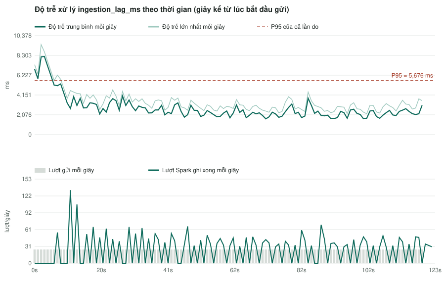

# Đo tải (B2)

Một mức tải: **25 lượt quét/giây trong 120 giây** (3000 lượt), gửi thẳng vào Kafka
bằng `scripts/load_test.py`, giờ nhận lấy đúng lúc gửi. Độ trễ là `ingestion_lag_ms = processing_ts −
received_at` của từng dòng `scan_event`: gồm thời gian chờ tới đợt kế tiếp (chu kỳ 1 giây) và thời gian
Spark xử lý một đợt (đọc Kafka, tra DB, tính, ghi trong một giao dịch).

Đo lúc 2026-11-26 22:10 (giờ Việt Nam).

## Cấu hình máy và pipeline

| Hạng mục | Giá trị |
|---|---|
| CPU | AMD EPYC 7763 64-Core Processor, 4 luồng thấy được trong Codespaces |
| RAM máy Codespaces | 15,994 MB |
| Hệ điều hành | Linux-6.8.0-1070-azure-x86_64-with-glibc2.39 |
| Spark | PySpark 4.1.3, `local[2]`, Bronze và Silver chung một tiến trình |
| Chu kỳ đợt Silver | 1 giây (`--silver-trigger-seconds`), tối đa 2000 bản tin/đợt (`--max-offsets-per-trigger`) |
| Chu kỳ đợt Bronze | 5 giây |
| Kafka | 1 broker, topic `scan-events` 3 phân vùng |
| Dữ liệu vé | 7 vé mẫu và mã vé giả trộn ngẫu nhiên (70% vé thật), hạt giống 2026 |

## Kết quả

| Chỉ số | Giá trị |
|---|---|
| Lượt gửi / Spark đã ghi | 3000 / 3000 (thiếu 0) |
| Tốc độ gửi thực tế | 25.0 lượt/giây |
| Thông lượng Spark (lượt ghi xong / thời gian từ lượt nhận đầu tới lượt ghi cuối) | **24.5 lượt/giây** |
| Đỉnh lượt ghi xong trong một giây | 133 lượt |
| Độ trễ trung bình | **2,785 ms** |
| P50 / P95 / P99 | 2,488 / **5,676** / 8,235 ms |
| Nhỏ nhất / lớn nhất | 1,085 / **9,435** ms |
| Phân bố kết quả | CANCELLED 313, INVALID 1169, USED 1490, VALID 5, WRONG_GATE 23 |



## CPU và RAM lúc chạy (mẫu mỗi ~2 giây)

CPU tính theo phần trăm của một lõi (200% = dùng trọn 2 lõi), giống cách `docker stats` báo.

| Thành phần | CPU TB % | CPU lớn nhất % | RAM TB MB | RAM lớn nhất MB |
|---|---|---|---|---|
| Spark: tiến trình Python | 9.0 | 15.0 | 64.7 | 65.2 |
| Spark: JVM | 147.6 | 254.8 | 1,759.8 | 1,944.6 |
| SQL Server (container) | 4.9 | 16.7 | 980.4 | 986.7 |
| Kafka (container) | 31.8 | 180.5 | 617.5 | 714.9 |
| API (container) | 3.4 | 15.0 | 88.7 | 95.0 |
| Cả máy Codespaces (đã dùng) | - | - | 5,450.7 | 5,712.9 |

Số liệu thô: `docs/performance_data/scans.csv`, `docs/performance_data/resources.csv`.

## Đọc kết quả

Phần này viết tay từ `docs/performance_data/scans.csv` (chạy lại `load_test.py` sẽ ghi đè cả tệp).

| Giai đoạn | Số lượt | Độ trễ TB | P50 | P95 | P99 | Lớn nhất | Vượt 3,000 ms |
|---|---|---|---|---|---|---|---|
| 10 giây đầu | 250 | 6,242 ms | - | 8,954 ms | - | 9,435 ms | 100% |
| Từ giây 20 trở đi (ổn định) | 2,500 | 2,396 ms | 2,330 ms | 3,648 ms | 4,248 ms | 4,679 ms | 18.0% |
| Cả lần đo | 3,000 | 2,785 ms | 2,488 ms | 5,676 ms | 8,235 ms | 9,435 ms | 28.4% |

- **Khởi động chậm.** 7.3 giây đầu Spark chưa ghi lượt nào: đợt đầu tiên có dữ liệu chậm hơn hẳn các đợt sau
  (nhiều khả năng do khởi động tiến trình Python và biên dịch kế hoạch lần đầu). Mọi lượt vượt 5,000 ms đều nằm
  trong 10 giây này, nên P95/P99 của cả lần đo cao hơn hẳn lúc ổn định.
- **Ổn định ở khoảng 2.4 giây.** Spark ghi theo đợt, trung bình 1.75 giây một đợt (67 đợt cho 3000 lượt), dài hơn
  chu kỳ 1 giây nên đợt sau bắt đầu ngay khi đợt trước xong. Độ trễ của một lượt gồm thời gian chờ đợt kế tiếp
  và thời gian xử lý một đợt, nên nằm trong khoảng 1.1–4.7 giây. Spark theo kịp tốc độ gửi (24.5 lượt/giây so với
  25), Kafka không còn tồn bản tin.
- **Ảnh hưởng tới API.** API đợi tối đa `SCAN_WAIT_MS` = 3,000 ms rồi trả 202, thiết bị hỏi lại bằng
  `GET /api/scan/:id` (file 15). Ở mức 25 lượt/giây có 28.4% lượt nhận 202 (18.0% khi đã ổn định). Nếu nâng
  `SCAN_WAIT_MS` lên 4,000 ms thì khi ổn định chỉ còn 2.1% lượt nhận 202. Trước buổi demo nên gửi vài lượt
  "làm nóng" để tránh 10 giây đầu.
- **RAM.** Cả máy Codespaces (gồm cả VS Code) dùng 5.4–5.7 GB, trong đó Spark JVM gần 1.9 GB, SQL Server 1 GB,
  Kafka 0.7 GB. Vì vậy máy 8 GB RAM là mức tối thiểu; máy 5.9 GB RAM của người viết code không chạy nổi.

## Chạy lại

```bash
./scripts/up.sh full                 # hoặc stream; đợi Spark in "[pipeline] Đang chạy"
./scripts/dev_event_window.sh now
python3 scripts/load_test.py --rate 25 --duration 120
./scripts/dev_event_window.sh demo   # trả lại giờ demo
```

Trong lúc đo đừng quét thêm (script lọc lượt của mình theo khoảng giờ nhận). Mở
`http://localhost:3000/app.html#dashboard` cùng lúc để xem số liệu tăng dần.
