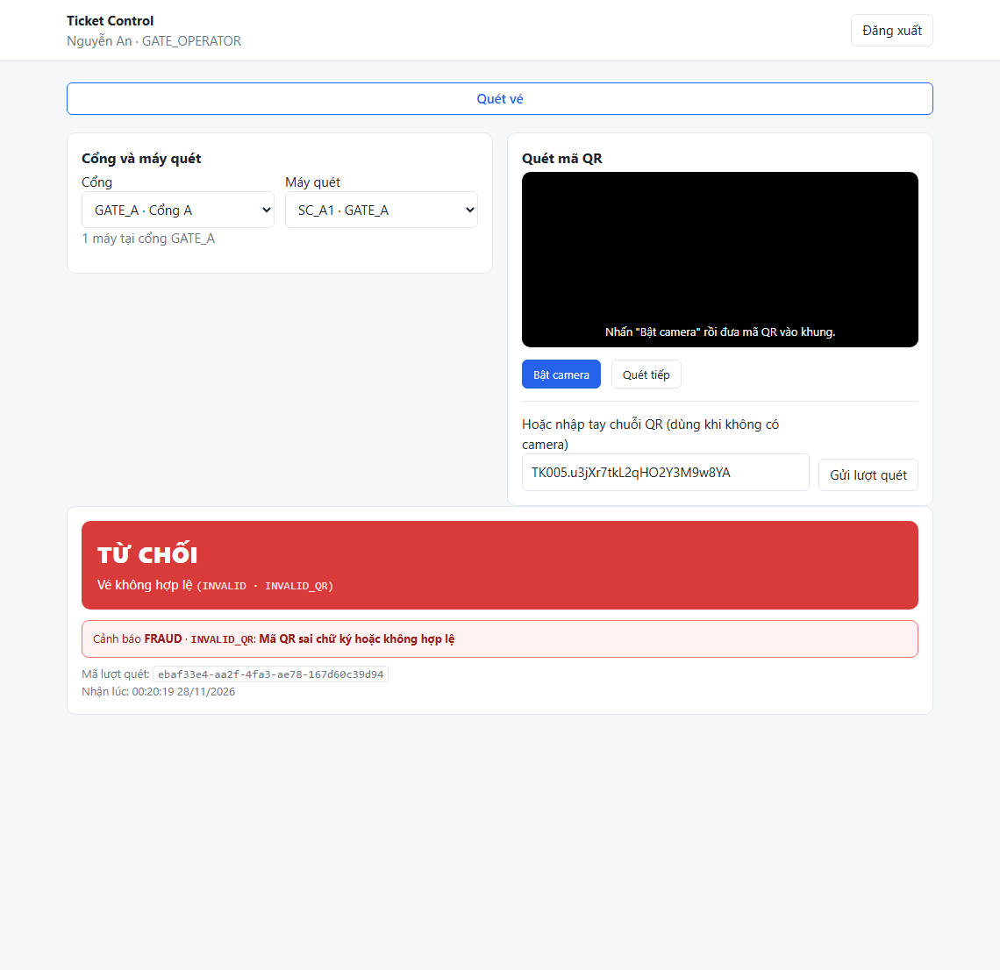

# Tài liệu Bảo mật Hệ thống (Role C)

## 1. Phân quyền Database (Least Privilege)
Hệ thống sử dụng hai tài khoản database riêng biệt được định nghĩa trong `database/security.sql`, không dùng tài khoản `sa` cho ứng dụng (đã cấu hình biến `DB_USER_API` / `DB_PASSWORD_API` cho `api` và `SPARK_DB_USER` / `SPARK_DB_PASSWORD` cho Spark; mật khẩu truyền qua biến `sqlcmd -v` từ `docker/.env`):
- **`api_user`**: Chỉ được đọc `scan_event`, `fraud_alert`, `gold_*`, `app_user`. Đọc/Ghi/Sửa/Xóa `ticket`, `event`, `event_gate`, `gate`, `scanner`. **Không có quyền ghi** `scan_event` hay `fraud_alert`.
- **`spark_user`**: Đọc/Ghi `scan_event`, `fraud_alert`, `gold_*`; `SELECT` và `UPDATE` trên bảng `ticket` (cập nhật `ticket_status`); `SELECT` trên các bảng cấu hình (`event`, `event_gate`, `gate`, `scanner`, `gate_travel_time`, `app_user`); và `EXECUTE` trên `dbo.usp_refresh_gold`.

**Ví dụ kiểm chứng thực tế — `api_user` thử `INSERT` vào `dbo.scan_event` bị từ chối (lỗi 229):**
```bash
$ docker compose -f docker/docker-compose.yml --env-file docker/.env exec -T sqlserver \
  /opt/mssql-tools18/bin/sqlcmd -S localhost -U api_user -P "$DB_PASSWORD_API" -d ticket_system -C -No -I \
  -Q "INSERT INTO dbo.scan_event (scan_event_id, event_id, ticket_id, scanner_id, gate_id, operator_id, raw_qr_payload, decode_error, scanned_at, received_at, processing_ts, scan_result, alert_level) VALUES (NEWID(), N'EV001', N'TK001', N'SC_A1', N'GATE_A', N'OP_A', N'TK001.test', 0, SYSDATETIME(), SYSDATETIME(), SYSDATETIME(), N'VALID', N'NONE');"

Msg 229, Level 14, State 5, Server b8d8f4456632, Line 1
The INSERT permission was denied on the object 'scan_event', database 'ticket_system', schema 'dbo'.
```

## 2. Chữ ký số trên mã QR (Chống vé giả)
- Mỗi mã QR được sinh ra theo công thức: `<ticket_id>.<chữ_ký_HMAC>`.
- Chữ ký được tạo bằng thuật toán `HMAC-SHA256` với Secret Key (`QR_HMAC_SECRET`) nằm trong biến môi trường (`base64url`, 16 byte đầu = 22 ký tự).
- Khi quét qua `POST /api/scan`, API kiểm tra chữ ký bằng `crypto.timingSafeEqual`. Nếu sai hoặc bị giả mạo, API vẫn đẩy sang Kafka với `decode_error = true` và `ticket_id = null` để Spark kết luận `scan_result = INVALID`, sinh cảnh báo `FRAUD` / `INVALID_QR`.

**Ảnh thực tế — Quét mã QR sai chữ ký (`TK005.forged_hmac_sig_000000`) trả về `INVALID · INVALID_QR`:**



## 3. Xác thực và Phân quyền (JWT)
- Người dùng đăng nhập qua `POST /api/login` và nhận JWT Token (HS256, hạn 12 giờ).
- Token chứa `sub` (`user_id`) và `role` (`GATE_OPERATOR` hoặc `EVENT_SUPERVISOR`).
- Mọi endpoint `/api/*` (trừ `/api/login` và `/api/health`) đều qua middleware `authenticate` và `requireRole`: thiếu/sai token trả `401`, đúng token nhưng sai vai trò trả `403`.

**Ví dụ kiểm chứng thực tế trên API (`http://localhost:3000`):**

1. **Gọi không có token → `401 Unauthorized`:**
```http
$ curl -s -i http://localhost:3000/api/dashboard/live
HTTP/1.1 401 Unauthorized
Content-Type: application/json; charset=utf-8

{"error":{"code":"UNAUTHENTICATED","message":"Thiếu token Bearer."}}
```

2. **Dùng token của `GATE_OPERATOR` (`op_gate_a`) gọi endpoint của `EVENT_SUPERVISOR` → `403 Forbidden`:**
```http
$ curl -s -i -H "Authorization: Bearer $OP_TOKEN" http://localhost:3000/api/dashboard/live
HTTP/1.1 403 Forbidden
Content-Type: application/json; charset=utf-8

{"error":{"code":"FORBIDDEN","message":"Tài khoản không có quyền gọi endpoint này."}}
```

## 4. Mã hóa mật khẩu
- Mật khẩu người dùng trong bảng `dbo.app_user` không lưu dạng văn bản thuần (plaintext), mà băm bằng `bcrypt` (cost 10, có salt). Khi đăng nhập, API kiểm tra bằng `bcrypt.compare`.

**Ví dụ kiểm chứng thực tế — Truy vấn `dbo.app_user`:**
```text
$ sqlcmd -S localhost -U sa -d ticket_system -C -No -I -W -Q "SELECT user_id, username, password_hash, role FROM dbo.app_user;"
user_id username   password_hash                                                role
------- --------   -------------                                                ----
OP_A    op_gate_a  $2b$10$uFh.p9INxlgA5mFgk14A3efGe603s2Hc/oBhFCU0X2Gv6jJRPFWJa GATE_OPERATOR
OP_B    op_gate_b  $2b$10$uFh.p9INxlgA5mFgk14A3efGe603s2Hc/oBhFCU0X2Gv6jJRPFWJa GATE_OPERATOR
OP_C    op_gate_c  $2b$10$uFh.p9INxlgA5mFgk14A3efGe603s2Hc/oBhFCU0X2Gv6jJRPFWJa GATE_OPERATOR
OP_D    op_gate_d  $2b$10$uFh.p9INxlgA5mFgk14A3efGe603s2Hc/oBhFCU0X2Gv6jJRPFWJa GATE_OPERATOR
SUP1    supervisor $2b$10$uFh.p9INxlgA5mFgk14A3efGe603s2Hc/oBhFCU0X2Gv6jJRPFWJa EVENT_SUPERVISOR
```

## 5. Bảo vệ thông tin nhạy cảm
- Các thông tin nhạy cảm (`DB_PASSWORD`, `DB_PASSWORD_API`, `SPARK_DB_PASSWORD`, `JWT_SECRET`, `QR_HMAC_SECRET`) được lưu trong `docker/.env`, không hardcode trong `database/security.sql` hay `docker/.env.example`.
- File `.env` đã được khai báo trong `.gitignore` và không nằm trong Git index.

**Ví dụ kiểm chứng thực tế — Kiểm tra các tệp `.env` được Git theo dõi:**
```bash
$ git ls-files | grep -E '(^|/)\.env'
docker/.env.example
```
