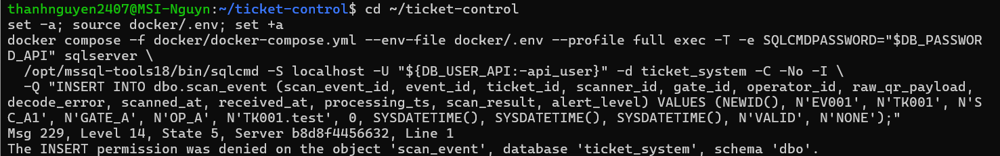
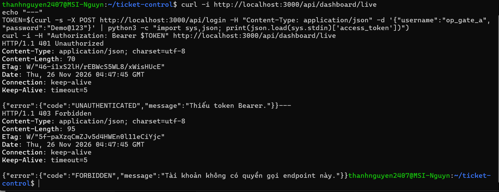
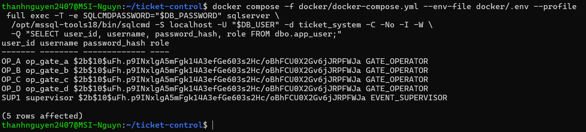
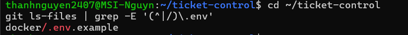
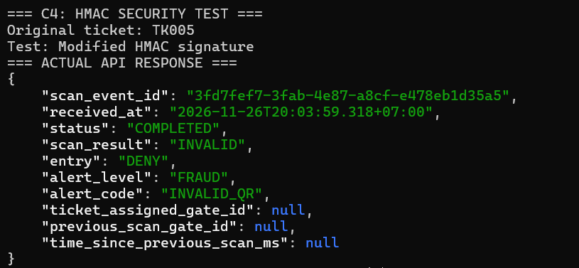
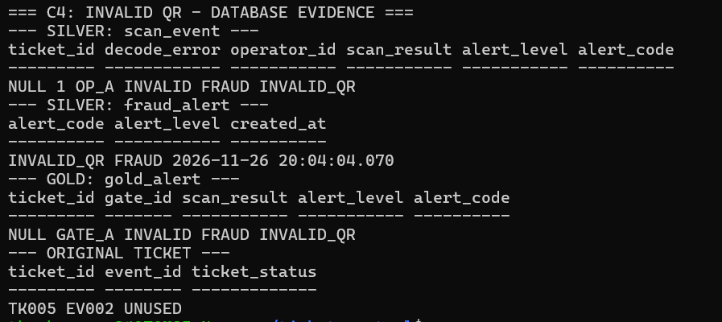
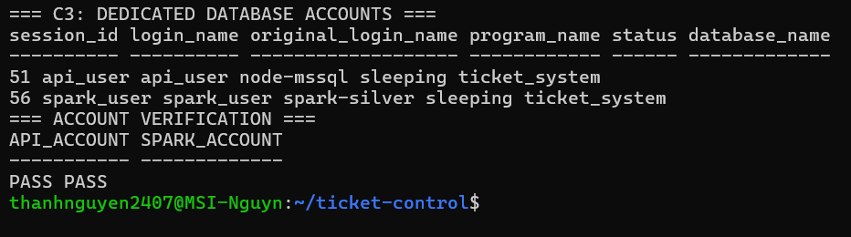
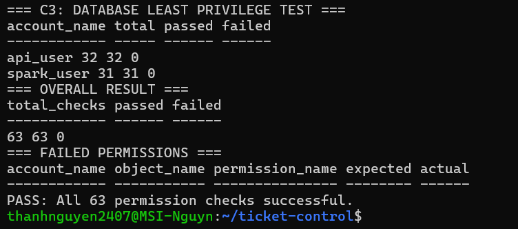
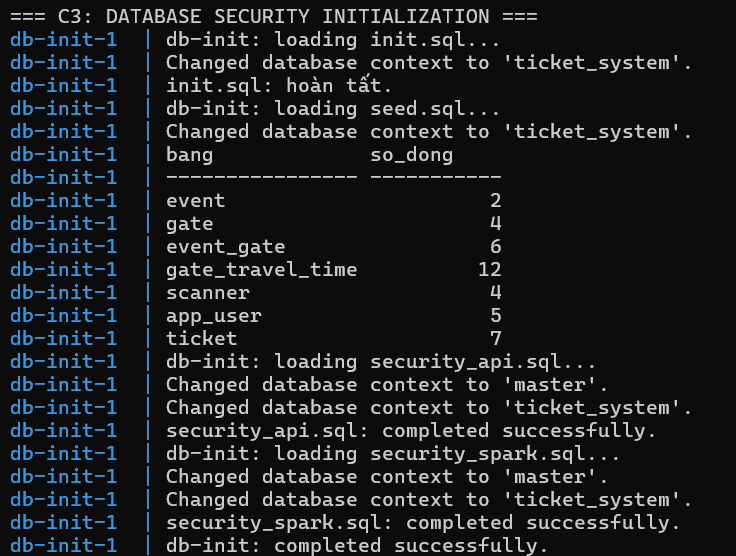

# Tài liệu bảo mật hệ thống (Role C)

## 1. Phân quyền cơ sở dữ liệu (Least Privilege)

### 1.1. Tài khoản cơ sở dữ liệu riêng biệt

Hệ thống hỗ trợ hai tài khoản SQL Server chuyên biệt:

- `api_user`: phục vụ Node.js REST API.
- `spark_user`: phục vụ Spark Streaming và xử lý Silver/Gold.

Trong chế độ sử dụng tài khoản chuyên biệt, API và Spark không sử dụng
tài khoản quản trị `sa` để thực hiện các nghiệp vụ thông thường.

Tài khoản `sa` được sử dụng cho các tác vụ quản trị, khởi tạo cơ sở dữ liệu,
phân quyền và bảo trì hệ thống.

Các script phân quyền:

| Tệp | Chức năng |
|---|---|
| `database/security_api.sql` | Khởi tạo và phân quyền cho `api_user` |
| `database/security_spark.sql` | Khởi tạo và phân quyền cho `spark_user` |
| `database/security.sql` | Script tổng hợp gọi hai script phân quyền |
| `docker/db-init/entrypoint.sh` | Khởi tạo database và từng tài khoản độc lập |

### 1.2. Cấu hình tài khoản

Các biến môi trường được khai báo trong `docker/.env`:

```dotenv
DB_USER_API=api_user
DB_PASSWORD_API=<api_password>

SPARK_DB_USER=spark_user
SPARK_DB_PASSWORD=<spark_password>
```

Mỗi cặp tên tài khoản và mật khẩu phải được cấu hình đầy đủ
hoặc cùng để trống.

| Cấu hình API | Cấu hình Spark | Hành vi |
|---|---|---|
| Để trống | Để trống | Cả hai sử dụng tài khoản DB mặc định |
| Đầy đủ | Để trống | Chỉ khởi tạo tài khoản API chuyên biệt |
| Để trống | Đầy đủ | Chỉ khởi tạo tài khoản Spark chuyên biệt |
| Đầy đủ | Đầy đủ | Khởi tạo cả hai tài khoản chuyên biệt |

Nếu một cặp chỉ có tên tài khoản hoặc chỉ có mật khẩu,
cấu hình bị từ chối thay vì kết hợp thông tin đăng nhập
của hai tài khoản khác nhau.

Mật khẩu được truyền vào các script SQL thông qua biến `sqlcmd -v`,
không ghi trực tiếp trong mã nguồn.

Đối với môi trường triển khai chính thức, cần cấu hình đầy đủ
cả hai tài khoản chuyên biệt để bảo đảm nguyên tắc Least Privilege.

### 1.3. Ma trận phân quyền

| Đối tượng | api_user | spark_user |
|---|---|---|
| `dbo.ticket` | SELECT, INSERT, UPDATE, DELETE | SELECT, UPDATE |
| `dbo.event` | SELECT, UPDATE | SELECT |
| `dbo.event_gate` | SELECT, INSERT, DELETE | SELECT |
| `dbo.gate` | SELECT | Không cấp |
| `dbo.scanner` | SELECT | SELECT |
| `dbo.gate_travel_time` | Không cấp | SELECT |
| `dbo.app_user` | SELECT | SELECT |
| `dbo.scan_event` | SELECT | SELECT, INSERT |
| `dbo.fraud_alert` | SELECT | INSERT |
| `dbo.gold_event_stats` | SELECT | Không cấp trực tiếp |
| `dbo.gold_gate_stats` | SELECT | Không cấp trực tiếp |
| `dbo.gold_alert` | SELECT | Không cấp trực tiếp |
| `dbo.usp_refresh_gold` | Không cấp | EXECUTE |

API không có quyền INSERT, UPDATE hoặc DELETE trực tiếp
trên bảng `scan_event` và `fraud_alert`.

Spark ghi nhận các lượt quét và cảnh báo mới, cập nhật trạng thái vé,
nhưng không được sửa hoặc xóa các bản ghi lịch sử quét.

Spark cập nhật tầng Gold thông qua stored procedure
`dbo.usp_refresh_gold`, thay vì được cấp quyền ghi trực tiếp
trên các bảng Gold.

### 1.4. Kiểm chứng phân quyền

Kết quả kiểm thử ngày 26/11/2026:

| Nội dung | Kết quả |
|---|---|
| Kiểm tra quyền hiệu lực của hai tài khoản | 63/63 PASS |
| Kiểm thử mô phỏng khởi tạo tài khoản độc lập | 8/8 PASS |
| Đăng nhập SQL Server bằng api_user | Thành công |
| Đăng nhập SQL Server bằng spark_user | Thành công |
| API hoạt động bằng api_user | Đã xác minh SQL Session |
| Spark hoạt động bằng spark_user | Đã xác minh SQL Session |
| Spark xử lý Silver và cập nhật Gold | Thành công |
| API thử INSERT trái phép vào scan_event | Bị từ chối, lỗi 229 |

Kiểm thử 8 trường hợp khởi tạo độc lập được thực hiện bằng
sqlcmd mô phỏng để xác minh luồng điều khiển của entrypoint,
không phải 8 lần dựng mới cơ sở dữ liệu thực tế.

### 1.5. Kiểm chứng thao tác ghi trái phép

Đăng nhập SQL Server bằng `api_user` và thực hiện:

```sql
SELECT ORIGINAL_LOGIN(), USER_NAME();

SELECT COUNT(*) FROM dbo.scan_event;

BEGIN TRY
    BEGIN TRANSACTION;

    INSERT INTO dbo.scan_event (scan_event_id)
    SELECT scan_event_id
    FROM dbo.scan_event
    WHERE 1 = 0;

    ROLLBACK TRANSACTION;

    THROW 50001, 'FAIL: INSERT was not denied.', 1;
END TRY
BEGIN CATCH
    IF @@TRANCOUNT > 0
        ROLLBACK TRANSACTION;

    SELECT ERROR_NUMBER(), ERROR_MESSAGE();

    IF ERROR_NUMBER() = 229
        PRINT 'PASS: Unauthorized INSERT denied';
    ELSE
        THROW;
END CATCH;
```

Truy vấn INSERT sử dụng điều kiện `WHERE 1 = 0`
để kiểm tra quyền mà không tạo thêm bản ghi.

Kết quả thực tế:

```text
Login: api_user
Error number: 229

The INSERT permission was denied on the object 'scan_event',
database 'ticket_system', schema 'dbo'.

PASS: Unauthorized INSERT denied
```



### 1.6. Quản lý mật khẩu tài khoản database

Các script tạo login nếu login chưa tồn tại.

Việc thay đổi mật khẩu trong `docker/.env` không tự động
thay đổi mật khẩu của login đã tồn tại trong SQL Server.

Khi cần đổi mật khẩu, quản trị viên phải thực hiện
`ALTER LOGIN` bằng tài khoản có quyền phù hợp,
sau đó đồng bộ cấu hình và khởi động lại dịch vụ liên quan.

Không sử dụng `docker compose down -v` chỉ để đổi mật khẩu
trên môi trường có dữ liệu cần giữ lại, vì thao tác này
có thể xóa các volume dữ liệu của hệ thống.

---

## 2. Xác thực mã QR bằng HMAC-SHA256

### 2.1. Cấu trúc mã QR

Mã QR của vé có cấu trúc:

```text
<ticket_id>.<hmac_signature>
```

Chữ ký HMAC được tạo từ mã vé và khóa bí mật
`QR_HMAC_SECRET` bằng thuật toán HMAC-SHA256.

Hệ thống sử dụng 16 byte đầu của kết quả HMAC,
mã hóa base64url không padding thành 22 ký tự.

HMAC là cơ chế xác thực thông điệp bằng khóa bí mật dùng chung,
không phải chữ ký số bất đối xứng và không mã hóa nội dung mã vé.

### 2.2. Quy trình xác thực

Khi nhận yêu cầu `POST /api/scan`, API thực hiện:

1. Xác thực JWT và kiểm tra vai trò GATE_OPERATOR.
2. Kiểm tra cấu trúc dữ liệu đầu vào.
3. Kiểm tra chữ ký HMAC của mã QR.
4. So sánh chữ ký bằng `crypto.timingSafeEqual`
   sau khi kiểm tra độ dài.
5. Nếu chữ ký hợp lệ, sử dụng mã vé đã xác thực,
   không tin tưởng trực tiếp mã vé do client cung cấp.
6. Nếu chữ ký không hợp lệ, đặt `decode_error = true`
   và `ticket_id = null`.
7. Kiểm tra cổng và máy quét.
8. Đẩy sự kiện vào Kafka để Spark xử lý.

API thực hiện kiểm tra tính xác thực của mã QR,
còn Spark chịu trách nhiệm kết luận nghiệp vụ.

Mã QR hợp lệ về HMAC không đồng nghĩa với việc vé
được phép vào sự kiện. Spark vẫn kiểm tra trạng thái vé,
sự kiện, thời gian nhận khách, cổng và lịch sử quét.

### 2.3. Kiểm thử QR bị giả mạo

Ngày kiểm thử: 26/11/2026.

Điều kiện kiểm thử:

- API, SQL Server, Kafka và Spark đang hoạt động.
- Khung giờ nhận khách được đưa về hiện tại bằng
  `./scripts/dev_event_window.sh now`.
- Đăng nhập bằng tài khoản GATE_OPERATOR.
- Sinh QR hợp lệ của vé TK005.
- Thay đổi một ký tự trong chữ ký HMAC,
  giữ nguyên mã vé và độ dài QR.
- Gửi QR đã sửa qua REST API thực tế,
  không gửi trực tiếp vào Kafka.

Dữ liệu đầu vào:

| Thuộc tính | Giá trị |
|---|---|
| ticket_id | TK005 |
| decode_error | false |
| gate_id | GATE_A |
| scanner_id | SC_A1 |
| Độ dài QR hợp lệ | 28 ký tự |
| Độ dài QR bị sửa | 28 ký tự |

API tiếp nhận lượt quét và ban đầu trả trạng thái PROCESSING.
Sau khi Spark hoàn tất xử lý, truy vấn kết quả trả về:

```json
{
  "scan_event_id": "3fd7fef7-3fab-4e87-a8cf-e478eb1d35a5",
  "received_at": "2026-11-26T20:03:59.318+07:00",
  "status": "COMPLETED",
  "scan_result": "INVALID",
  "entry": "DENY",
  "alert_level": "FRAUD",
  "alert_code": "INVALID_QR",
  "ticket_assigned_gate_id": null,
  "previous_scan_gate_id": null,
  "time_since_previous_scan_ms": null
}
```

### 2.4. Kiểm chứng dữ liệu Silver và Gold

| Thuộc tính | Kết quả thực tế |
|---|---|
| scan_event_id | 3FD7FEF7-3FAB-4E87-A8CF-E478EB1D35A5 |
| event_id | EV001 |
| ticket_id | NULL |
| operator_id | OP_A |
| gate_id | GATE_A |
| scanner_id | SC_A1 |
| decode_error | 1 |
| scan_result | INVALID |
| alert_level | FRAUD |
| alert_code | INVALID_QR |

Bảng `dbo.fraud_alert` ghi nhận cảnh báo INVALID_QR
với mức FRAUD tại thời điểm 20:04:04.070 ngày 26/11/2026.

Bảng `dbo.gold_alert` chứa cảnh báo tương ứng với
cùng scan_event_id.

Vé TK005 thuộc EV002 vẫn giữ nguyên trạng thái UNUSED.

Kết quả: PASS.

API không chấp nhận mã vé từ QR có chữ ký sai.
Spark từ chối lượt quét, lưu cảnh báo gian lận
và không thay đổi trạng thái vé thật.

### 2.5. Phạm vi bảo vệ

HMAC giúp phát hiện việc sửa đổi mã vé hoặc chữ ký QR
khi khóa bí mật chưa bị lộ.

HMAC không ngăn được việc sao chép nguyên vẹn một mã QR
hợp lệ. Các trường hợp sử dụng lại vé hoặc dùng chung vé
được phát hiện bằng logic nghiệp vụ của Spark,
bao gồm DUPLICATE_SCAN và IMPOSSIBLE_TRAVEL.

---

## 3. Xác thực và phân quyền bằng JWT

### 3.1. Authentication

Người dùng đăng nhập thông qua `POST /api/login`.

Sau khi xác thực thông tin đăng nhập, API phát hành JWT
sử dụng thuật toán HS256.

Thời hạn token mặc định là 12 giờ,
có thể cấu hình thông qua `JWT_EXPIRES_IN`.

Token chứa thông tin định danh người dùng (`sub`),
vai trò (`role`) và các trường thời gian của JWT.

Client gửi token trong HTTP header:

```http
Authorization: Bearer <access_token>
```

Middleware `authenticate` kiểm tra tính hợp lệ
và thời hạn của token trước khi xử lý yêu cầu.

### 3.2. Authorization (RBAC)

Hệ thống sử dụng hai vai trò:

- GATE_OPERATOR: nhân viên soát vé.
- EVENT_SUPERVISOR: người quản lý và giám sát sự kiện.

| Chức năng | GATE_OPERATOR | EVENT_SUPERVISOR |
|---|---|---|
| Quét vé | Có | Không |
| Tra cứu kết quả quét | Có | Không |
| Tra cứu chi tiết vé | Có | Có |
| Xem danh sách vé | Không | Có |
| Sinh QR | Không | Có |
| Thêm, sửa, xóa vé | Không | Có |
| Thu hồi vé | Không | Có |
| Dashboard Live | Không | Có |
| Quản lý sự kiện | Không | Có |
| Tra cứu cổng | Có | Có |
| Tra cứu scanner | Có | Có |

Các endpoint nghiệp vụ yêu cầu xác thực JWT.

Middleware `requireRole` được áp dụng tại những endpoint
cần giới hạn vai trò. Các route tra cứu cổng và scanner
yêu cầu xác thực nhưng không giới hạn riêng một vai trò.

Endpoint đăng nhập và kiểm tra sức khỏe hệ thống
không yêu cầu JWT.

### 3.3. Kiểm chứng HTTP 401

Gọi Dashboard API mà không gửi token:

```bash
curl -s -i http://localhost:3000/api/dashboard/live
```

Kết quả:

```http
HTTP/1.1 401 Unauthorized
```

```json
{
  "error": {
    "code": "UNAUTHENTICATED",
    "message": "Thiếu token Bearer."
  }
}
```

### 3.4. Kiểm chứng HTTP 403

Sử dụng JWT hợp lệ của GATE_OPERATOR để gọi Dashboard API:

```bash
curl -s -i \
  -H "Authorization: Bearer $OP_TOKEN" \
  http://localhost:3000/api/dashboard/live
```

Kết quả:

```http
HTTP/1.1 403 Forbidden
```

```json
{
  "error": {
    "code": "FORBIDDEN",
    "message": "Tài khoản không có quyền gọi endpoint này."
  }
}
```

HTTP 401 thể hiện yêu cầu chưa được xác thực hợp lệ.
HTTP 403 thể hiện người dùng đã được xác thực
nhưng không có quyền thực hiện chức năng.



---

## 4. Băm mật khẩu bằng Bcrypt

### 4.1. Cơ chế lưu trữ mật khẩu

Mật khẩu người dùng không được lưu dưới dạng plaintext
trong bảng `dbo.app_user`.

Hệ thống sử dụng bcrypt với cost factor bằng 10.

Bcrypt là thuật toán băm mật khẩu một chiều có salt,
không phải thuật toán mã hóa có thể giải mã ngược.

Khi đăng nhập, API sử dụng `bcrypt.compareSync`
để đối chiếu mật khẩu được cung cấp với password_hash
đã lưu trong cơ sở dữ liệu.

API không trả password_hash trong phản hồi đăng nhập.

### 4.2. Kiểm chứng dữ liệu

Có thể kiểm tra định dạng hash mà không hiển thị
toàn bộ giá trị password_hash:

```sql
SELECT
    user_id,
    username,
    LEFT(password_hash, 7) AS bcrypt_prefix,
    LEN(password_hash) AS hash_length,
    role
FROM dbo.app_user;
```

Dữ liệu seed sử dụng bcrypt với tiền tố `$2b$10$`.

Năm tài khoản mẫu gồm bốn GATE_OPERATOR
và một EVENT_SUPERVISOR.

### 4.3. Giải thích các password_hash giống nhau

Năm tài khoản mẫu có cùng password_hash vì dữ liệu seed
sử dụng chung một mật khẩu demo và tái sử dụng
cùng một giá trị bcrypt hash đã tạo sẵn.

Điều này không có nghĩa bcrypt không sử dụng salt.

Nếu cùng một mật khẩu được băm độc lập nhiều lần
với salt ngẫu nhiên khác nhau, các giá trị hash
thông thường sẽ khác nhau.

Việc sử dụng chung mật khẩu và hash chỉ phù hợp
với dữ liệu mẫu phục vụ kiểm thử, không phải
thực hành bảo mật được khuyến nghị cho môi trường production.

Trong môi trường triển khai thực tế, mỗi người dùng
cần có mật khẩu riêng và được băm độc lập.



---

## 5. Bảo vệ thông tin nhạy cảm

### 5.1. Quản lý secrets

Các thông tin nhạy cảm được cấu hình trong `docker/.env`:

- `DB_PASSWORD`
- `DB_PASSWORD_API`
- `SPARK_DB_PASSWORD`
- `JWT_SECRET`
- `QR_HMAC_SECRET`

Tệp `docker/.env.example` chỉ chứa cấu hình mẫu,
không chứa mật khẩu hoặc khóa bí mật thực tế.

Các script phân quyền nhận mật khẩu qua biến môi trường
và biến sqlcmd, thay vì hardcode trong mã nguồn.

### 5.2. Kiểm chứng Git

Thực hiện:

```bash
git check-ignore docker/.env

git ls-files -- docker/.env

git ls-files | grep -E '(^|/)\.env'
```

Kết quả kiểm chứng:

- `docker/.env` được Git ignore.
- `git ls-files -- docker/.env` không trả về tệp nào.
- Tệp cấu hình mẫu `docker/.env.example`
  được phép quản lý bằng Git.



Không đưa mật khẩu database, JWT thực tế hoặc khóa HMAC
vào tài liệu, ảnh minh chứng hay Git repository.

---

## 6. Kiểm tra dữ liệu đầu vào và tính toàn vẹn

Scan API kiểm tra các thông tin đầu vào:

- raw_qr_payload không rỗng và tối đa 512 ký tự.
- decode_error phải có kiểu boolean.
- gate_id và scanner_id phải đúng định dạng.
- scanned_at phải là ISO 8601 có thông tin múi giờ.
- Cổng và scanner phải tồn tại trong cơ sở dữ liệu.
- Scanner phải thuộc đúng cổng được khai báo.

API lấy operator_id từ JWT đã xác thực,
không sử dụng trực tiếp định danh người quét do client cung cấp.

Các truy vấn SQL trong Scan API sử dụng tham số
thông qua phương thức `.input()` của thư viện mssql,
giúp hạn chế nguy cơ SQL Injection tại các truy vấn này.

API không tự ghi trực tiếp kết quả nghiệp vụ vào Silver.
Sự kiện được chuyển qua Kafka để Spark xử lý và ghi dữ liệu
bằng tài khoản database có quyền phù hợp.

---

## 7. Tổng hợp kết quả kiểm thử

| Nhóm kiểm thử | Kết quả |
|---|---|
| QR HMAC | 6/6 PASS |
| Xử lý thời gian | 4/4 PASS |
| JWT Authentication và Authorization | 5/5 PASS |
| API Routes, C1 và C2 | 15/15 PASS |
| Tổng kiểm thử tự động API | 30/30 PASS |
| Quyền hiệu lực SQL Server | 63/63 PASS |
| Mô phỏng khởi tạo tài khoản độc lập | 8/8 PASS |
| API sử dụng api_user | PASS |
| Spark sử dụng spark_user | PASS |
| INSERT trái phép vào scan_event | PASS - Error 229 |
| QR giả qua REST API thực tế | PASS |
| Kiểm chứng Silver và Gold của QR giả | PASS |
| Vé thật không bị thay đổi trạng thái | PASS |
| Git không theo dõi docker/.env | PASS |

Các nhóm kiểm thử tự động, kiểm thử mô phỏng
và kiểm thử tích hợp được trình bày riêng,
không đánh đồng chúng thành cùng một loại kiểm thử.

---

## 8. Giới hạn và khuyến nghị triển khai

Các kết quả trên xác minh những cơ chế bảo mật
đã được hiện thực và kiểm thử trong môi trường phát triển.

Chúng không thay thế một cuộc đánh giá an toàn thông tin
hoặc kiểm thử xâm nhập toàn diện.

Khi triển khai production, cần xem xét:

- Bắt buộc sử dụng tài khoản database chuyên biệt.
- Sử dụng HTTPS/TLS để bảo vệ dữ liệu truyền tải.
- Không sử dụng chung mật khẩu demo.
- Quản lý và luân chuyển khóa bí mật an toàn.
- Giới hạn truy cập trực tiếp đến SQL Server và Kafka.
- Bổ sung rate limiting và cơ chế giám sát đăng nhập.
- Xây dựng chính sách sao lưu, phục hồi và lưu giữ nhật ký.

Các nội dung này là khuyến nghị triển khai,
không phải tuyên bố rằng toàn bộ đã được hiện thực.

---

## 9. Minh chứng thực nghiệm bổ sung

### 9.1. Kiểm thử QR giả qua REST API



### 9.2. Kiểm chứng QR giả trong Silver và Gold



### 9.3. API và Spark sử dụng tài khoản chuyên biệt



### 9.4. Kết quả kiểm tra 63 quyền database



### 9.5. Khởi tạo tài khoản database


