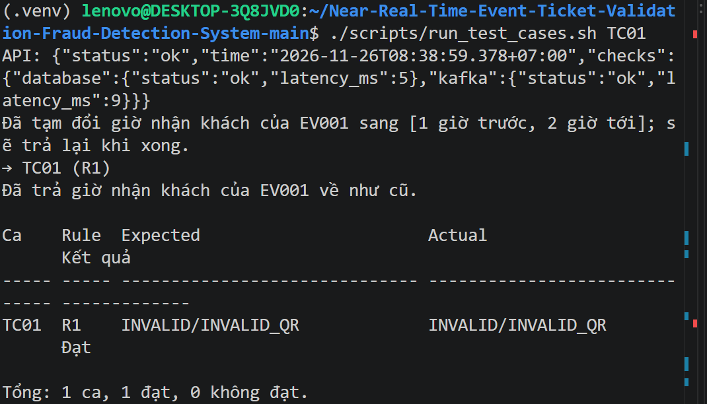
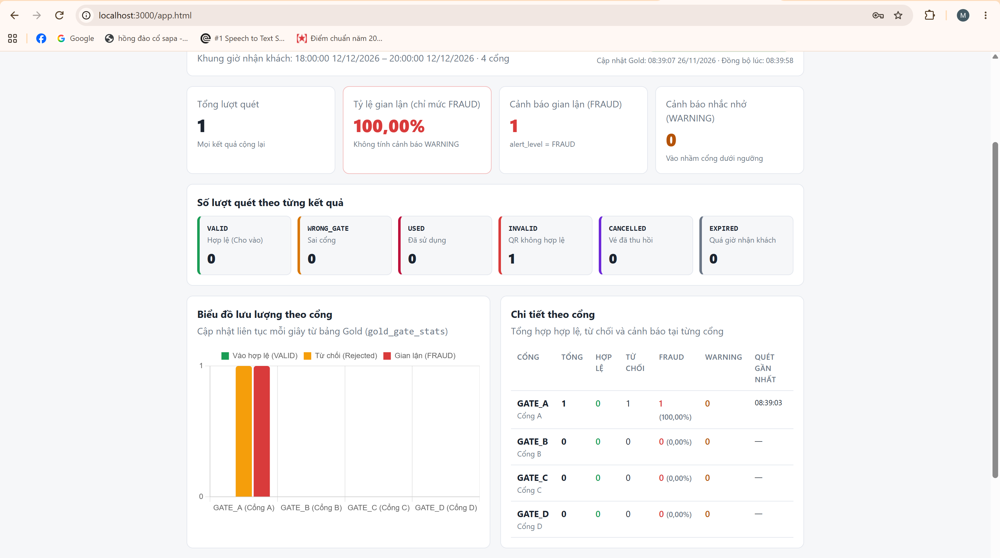
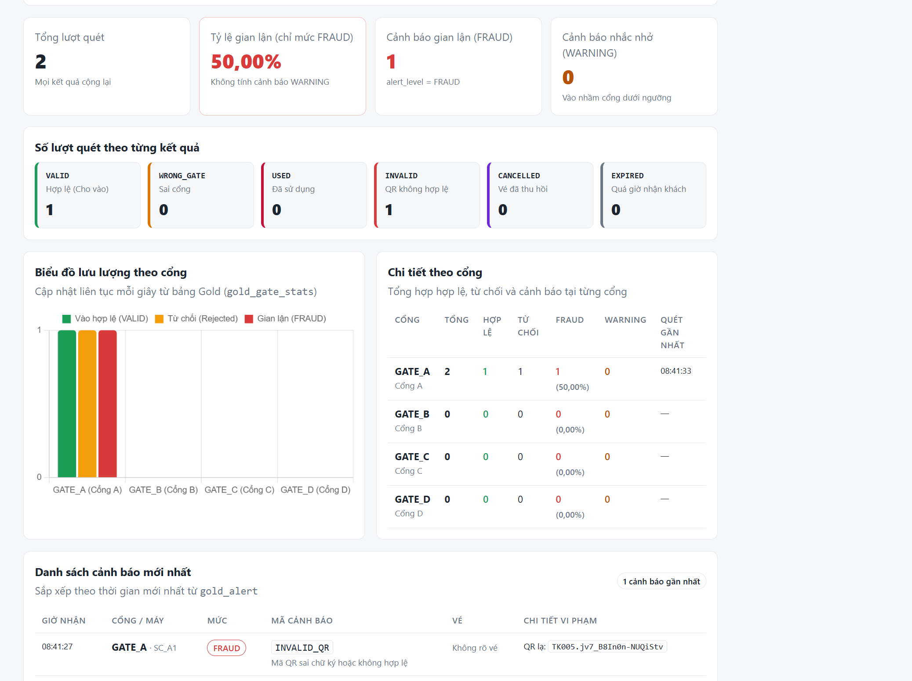
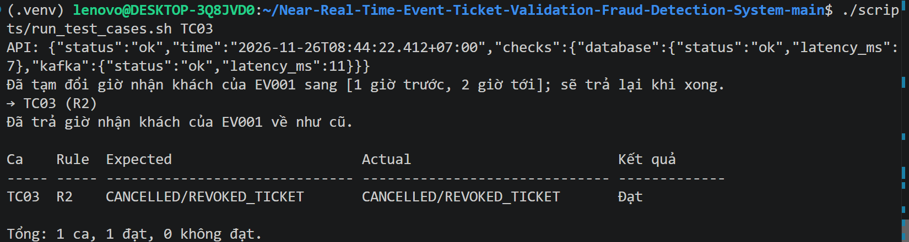
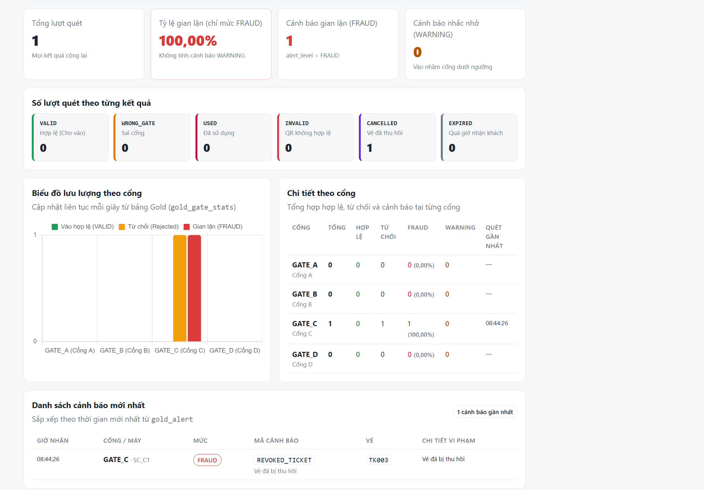
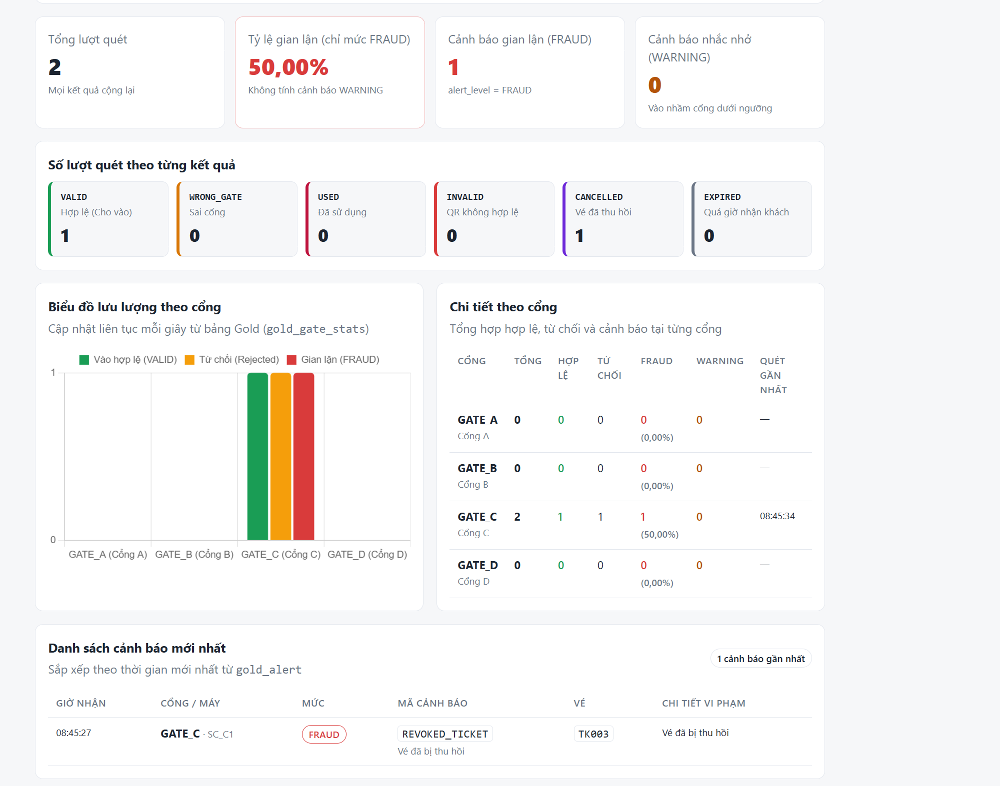
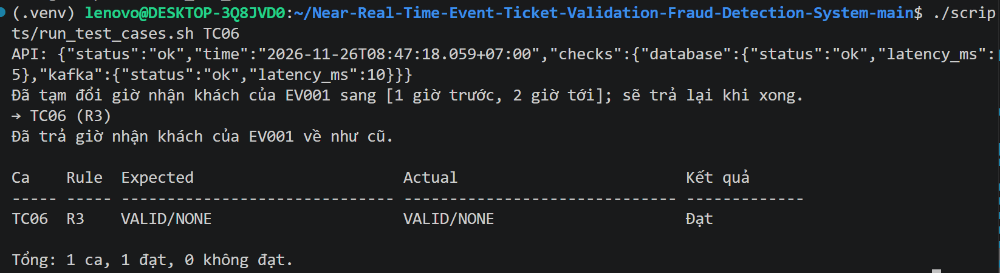
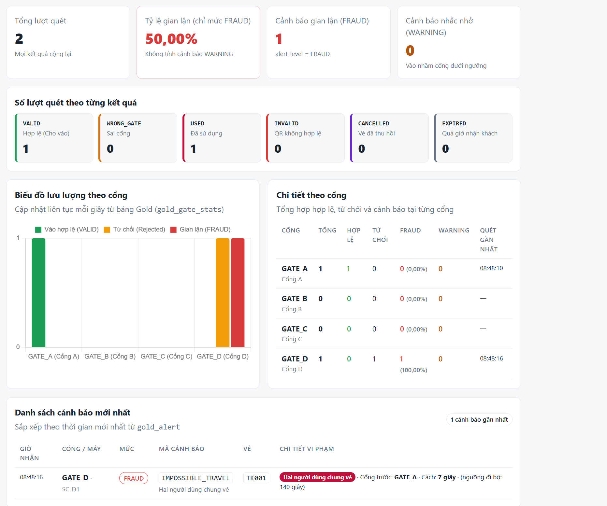
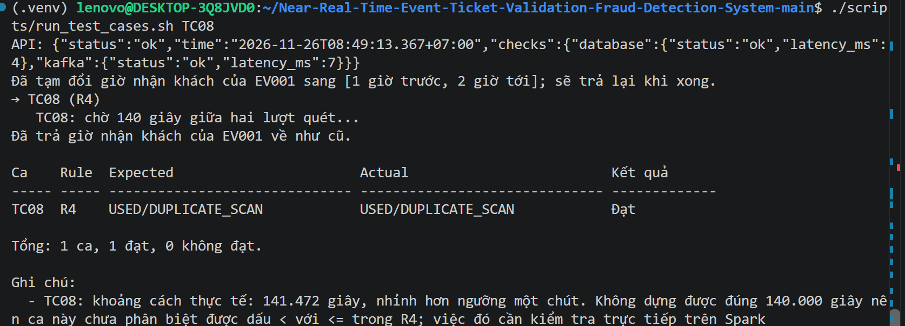
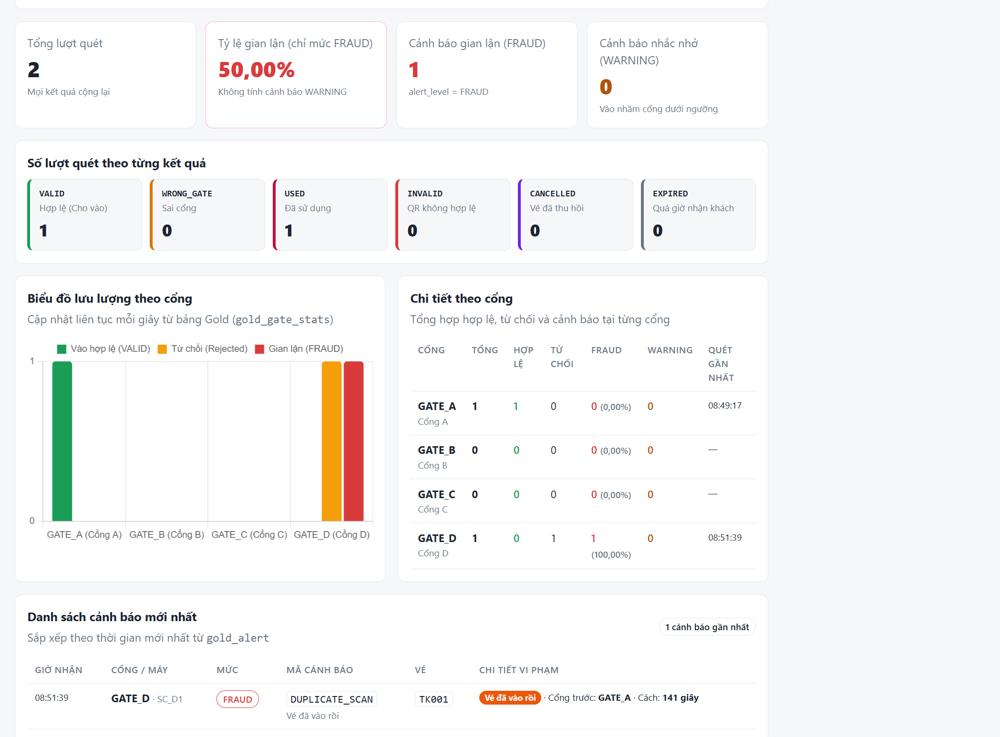

# Báo cáo kiểm thử TC01–TC08

Báo cáo kiểm thử bốn quy tắc gian lận R1–R4 (`Requirements/09_Fraud_Rules.md`) theo 8 ca ở
`Requirements/10_Test_Cases.md`.


## 1. Kết quả tổng hợp

Tổng: 8 ca, **8 đạt**. TC08 không đạt ở lần chạy đầu do lỗi tính giờ của script (không phải lỗi luật R4); sau khi sửa script và chạy lại thì đạt (xem mục 3).

| Ca | Quy tắc | Tình huống | Mong đợi | Thực tế | Đạt/Không |
|---|---|---|---|---|---|
| TC01 | R1 | Vé thật nhưng thuộc sự kiện khác | `INVALID` / `INVALID_QR` | `INVALID` / `INVALID_QR` | Đạt |
| TC02 | R1 | Vé đúng sự kiện, quét ngay sau một vé bị từ chối | `VALID` / không có | `VALID` / không có | Đạt |
| TC03 | R2 | Vé đã bị thu hồi | `CANCELLED` / `REVOKED_TICKET` | `CANCELLED` / `REVOKED_TICKET` | Đạt |
| TC04 | R2 | Vé cùng đợt phát hành nhưng chưa bị thu hồi | `VALID` / không có | `VALID` / không có | Đạt |
| TC05 | R3 | Vé đã vào, quét lại ở cùng cổng | `USED` / `DUPLICATE_SCAN` | `USED` / `DUPLICATE_SCAN` | Đạt (xem ghi chú) |
| TC06 | R3 | Vé khác quét ở cùng cổng, cách 2 giây | `VALID` / không có | `VALID` / không có | Đạt |
| TC07 | R4 | Cùng vé, hai cổng xa nhau, cách 3 giây | `USED` / `IMPOSSIBLE_TRAVEL` | `USED` / `IMPOSSIBLE_TRAVEL` | Đạt |
| TC08 | R4 | Cùng vé, hai cổng xa nhau, cách đúng ngưỡng | `USED` / `DUPLICATE_SCAN` | `USED` / `DUPLICATE_SCAN` (chạy lại sau khi sửa script) | Đạt (xem mục 3) |

## 2. Chi tiết từng ca

### TC01 — R1 bắt được: vé thuộc sự kiện khác
- **Dữ liệu:** `TK005` (thuộc `EV002`, `UNUSED`), quét tại `GATE_A` bằng `SC_A1`.
- **Mong đợi:** `INVALID`, cảnh báo FRAUD `INVALID_QR`, không cho vào, `TK005` giữ `UNUSED`.
- **Thực tế:** `INVALID` / `INVALID_QR`.
- **Kết quả:** Đạt.
- **Dashboard:** 1 lượt quét, `INVALID` = 1, 1 cảnh báo FRAUD tại `GATE_A`.
- **Ảnh terminal:** 
- **Ảnh Dashboard:** 

### TC02 — R1 không báo nhầm
- **Dữ liệu:** `TK005` bị từ chối, ngay sau đó `TK006` (`EV001`) quét tại `GATE_A` bằng cùng máy `SC_A1`.
- **Mong đợi:** `TK006` ra `VALID`, không có cảnh báo, chuyển `UNUSED` → `VALID_ENTRY`.
- **Thực tế:** `VALID` / không có cảnh báo.
- **Kết quả:** Đạt.
- **Dashboard:** 2 lượt quét (`INVALID` = 1, `VALID` = 1); danh sách cảnh báo chỉ có `INVALID_QR` của `TK005`, vé `TK006` quét sau đó không sinh cảnh báo.
- **Ảnh terminal:** 
- **Ảnh Dashboard:** 

### TC03 — R2 bắt được: vé đã bị thu hồi
- **Dữ liệu:** `TK003` (`EV001`, `GATE_C`, `CANCELLED`), quét tại `GATE_C` bằng `SC_C1`.
- **Mong đợi:** `CANCELLED`, cảnh báo FRAUD `REVOKED_TICKET`, không cho vào, `TK003` giữ `CANCELLED`.
- **Thực tế:** `CANCELLED` / `REVOKED_TICKET`.
- **Kết quả:** Đạt.
- **Dashboard:** `CANCELLED` = 1, cảnh báo `REVOKED_TICKET` cho `TK003` tại `GATE_C` / `SC_C1`.
- **Ảnh terminal:** 
- **Ảnh Dashboard:** 

### TC04 — R2 không báo nhầm
- **Dữ liệu:** `TK007` (`EV001`, `GATE_C`, `UNUSED`) quét tại `GATE_C` ngay sau `TK003` bị từ chối.
- **Mong đợi:** `VALID`, không cảnh báo, `UNUSED` → `VALID_ENTRY`.
- **Thực tế:** `VALID` / không có cảnh báo.
- **Kết quả:** Đạt.
- **Dashboard:** 2 lượt quét (`VALID` = 1, `CANCELLED` = 1); chỉ có cảnh báo `REVOKED_TICKET` của `TK003`, `TK007` không bị báo nhầm.
- **Ảnh terminal:** 
- **Ảnh Dashboard:** 

### TC05 — R3 bắt được: vé đã vào, quét lại ở cùng cổng
- **Dữ liệu:** `TK002` đã vào hợp lệ tại `GATE_B`, quét lại tại `GATE_B` bằng `SC_B1`.
- **Mong đợi:** `USED`, cảnh báo FRAUD `DUPLICATE_SCAN`, không cho vào, `VALID_ENTRY` → `FLAGGED_FRAUD`.
- **Thực tế:** `USED` / `DUPLICATE_SCAN`.
- **Kết quả:** Đạt.
- **Ghi chú:** `10_Test_Cases.md` quy định cách 30 phút, nhưng lần chạy này dùng khoảng cách **5 giây**
  (mặc định `TC05_GAP_SECONDS=5`). R3 không phụ thuộc khoảng cách thời gian nên kết luận vẫn có giá trị.
  Chạy đúng 30 phút: `TC05_GAP_SECONDS=1800 ./scripts/run_test_cases.sh TC05`.
- **Dashboard:** `VALID` = 1, `USED` = 1; cảnh báo `DUPLICATE_SCAN` cho `TK002` tại `GATE_B` / `SC_B1`, cổng trước `GATE_B`, cách 9 giây (5 giây chờ cấu hình cộng độ trễ xử lý).
- **Ảnh terminal:** 
- **Ảnh Dashboard:** 

### TC06 — R3 không báo nhầm: vé khác, cùng cổng, cách 2 giây
- **Dữ liệu:** `TK002` vào hợp lệ tại `GATE_B`; 2 giây sau `TK004` (`GATE_B`, `UNUSED`) quét tại `GATE_B`.
- **Mong đợi:** `TK004` ra `VALID`, không cảnh báo, `UNUSED` → `VALID_ENTRY`.
- **Thực tế:** `VALID` / không có cảnh báo.
- **Kết quả:** Đạt.
- **Dashboard:** `VALID` = 2 tại `GATE_B`, tỷ lệ gian lận 0,00%, danh sách cảnh báo trống ("Chưa có cảnh báo nào").
- **Ảnh terminal:** 
- **Ảnh Dashboard:** 

### TC07 — R4 bắt được: cùng vé, hai cổng xa nhau, cách vài giây
- **Dữ liệu:** `TK001` vào hợp lệ tại `GATE_A`; vài giây sau quét tại `GATE_D` bằng `SC_D1`. Ngưỡng A↔D là 140 giây.
- **Mong đợi:** `USED`, cảnh báo FRAUD `IMPOSSIBLE_TRAVEL`, không cho vào, `VALID_ENTRY` → `FLAGGED_FRAUD`.
- **Thực tế:** `USED` / `IMPOSSIBLE_TRAVEL`.
- **Kết quả:** Đạt.
- **Ghi chú:** Script chờ 3 giây giữa hai lượt quét. Ở lần chạy đầu (trước khi sửa script), dòng "khoảng cách thực tế" in sai đơn vị
  (`5909000.000 giây`, nano giây thay vì mili giây), xem mục 3. Ảnh chụp lấy từ lần chạy sau khi sửa: khoảng cách thực tế **6,665 giây**
  (ngưỡng A↔D là 140 giây).
- **Dashboard:** `VALID` = 1 (`GATE_A`), `USED` = 1 (`GATE_D`); cảnh báo `IMPOSSIBLE_TRAVEL` cho `TK001`, nhãn "Hai người dùng chung vé", cổng trước `GATE_A`, cách 7 giây, ngưỡng đi bộ 140 giây.
- **Ảnh terminal:** 
- **Ảnh Dashboard:** 

### TC08 — R4 không báo nhầm: cách đúng bằng ngưỡng
- **Dữ liệu:** `TK001` vào hợp lệ tại `GATE_A`; quét tại `GATE_D` bằng `SC_D1` sau khi đã chờ qua ngưỡng 140 giây.
- **Mong đợi:** `USED`, cảnh báo FRAUD **`DUPLICATE_SCAN`** (không phải `IMPOSSIBLE_TRAVEL`), không cho vào, `VALID_ENTRY` → `FLAGGED_FRAUD`.
- **Thực tế:**
  - Lần chạy 1 (script chưa sửa): `USED` / `IMPOSSIBLE_TRAVEL`, **không đạt**. Nguyên nhân do script, xem mục 3.
  - Lần chạy 2 (đã sửa script, khoảng cách thực tế 141,072 giây): `USED` / `DUPLICATE_SCAN`, **đạt**.
  - Lần chạy 3 (ảnh chụp kèm theo, khoảng cách thực tế 141,472 giây): `USED` / `DUPLICATE_SCAN`, **đạt**.
- **Dashboard:** `VALID` = 1, `USED` = 1; cảnh báo `DUPLICATE_SCAN` cho `TK001` tại `GATE_D` / `SC_D1`, nhãn "Vé đã vào rồi", cổng trước `GATE_A`, cách 141 giây (không phải `IMPOSSIBLE_TRAVEL`).
- **Kết quả:** Đạt.
- **Giới hạn:** qua API không dựng được đúng 140,000 giây (script chờ 140,5 giây), nên ca này kiểm tra "lớn hơn ngưỡng
  một chút" chứ chưa phân biệt `<` với `<=` ở đúng ranh giới. Phần đó do `./scripts/test_boundaries.sh` kiểm tra (xem mục 3).
- **Ảnh terminal:** 
- **Ảnh Dashboard:** 

---

## 3. Ca không đạt ở lần chạy đầu: TC08

**Hiện tượng.** Lần chạy 1, script báo `USED/IMPOSSIBLE_TRAVEL`, mong đợi `USED/DUPLICATE_SCAN`.

**Chẩn đoán.** Dòng "khoảng cách thực tế" script in ra là `4188000.000 giây`, vô lý. Truy vấn dữ liệu thật của `TK001`:

```
GATE_A|VALID|NULL|2026-11-26 08:25:04.115|NULL|NULL
GATE_D|USED|IMPOSSIBLE_TRAVEL|2026-11-26 08:25:08.303|4188|140000
```

Hai lượt quét thực tế chỉ cách nhau **4188 ms** (< 140000 ms), nên `IMPOSSIBLE_TRAVEL` là kết quả **đúng** của R4.
Lỗi nằm ở script, không nằm ở Silver.

**Nguyên nhân gốc.** `run_test_cases.sh` lấy mili giây bằng `date +%s%3N`. Bản `date` trên máy chạy trả về
**nano giây** (9 chữ số lẻ) thay vì mili giây, nên vòng chờ 140 giây thực chất chỉ chờ 0,14 mili giây và lần chạy
lại TC08 chỉ mất 12,7 giây. Con số in ra bị nhân 1.000.000 (4188 ms hiện thành 4188000000).

**Cách sửa.** Đổi mọi chỗ lấy mili giây sang `$(( $(date +%s%N) / 1000000 ))` trong `run_test_cases.sh`; hàm
`epoch_ms` sửa thành `echo $(( $(date -d "$1" +%s%N) / 1000000 ))`. Cùng lỗi này ở `backup_db.sh`, `restore_db.sh`,
`demo_backup_restore.sh` (đo thời gian sao lưu/khôi phục), đã sửa tương tự.

**Chạy lại sau khi sửa.** `./scripts/run_test_cases.sh TC08` mất 2 phút 29 giây (đúng kỳ vọng), khoảng cách thực tế
141,072 giây, kết quả `USED/DUPLICATE_SCAN`: **Đạt**. Chạy thêm lần nữa để chụp ảnh: 141,472 giây, vẫn **Đạt**.

**Ranh giới đúng 140 giây.** Để phân biệt `<` với `<=` cần `./scripts/test_boundaries.sh` (gửi thẳng vào Kafka với
thời gian chính xác; script xóa dữ liệu quét và tắt Spark nên chạy sau cùng).


