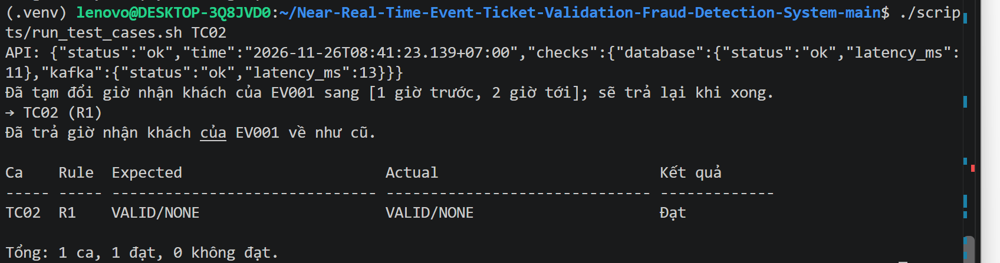
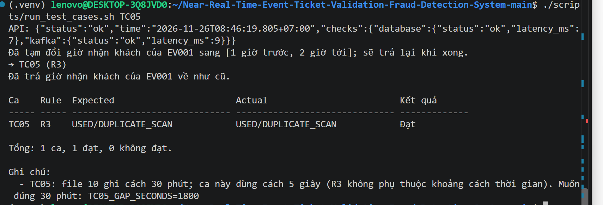
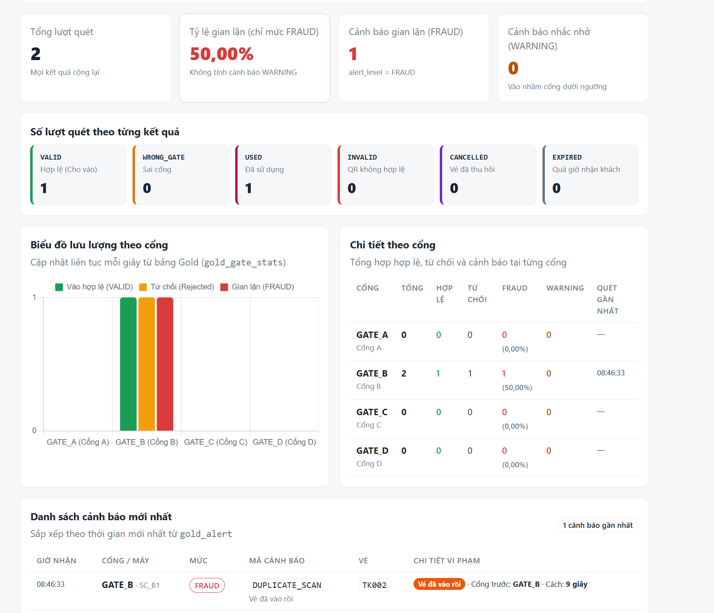
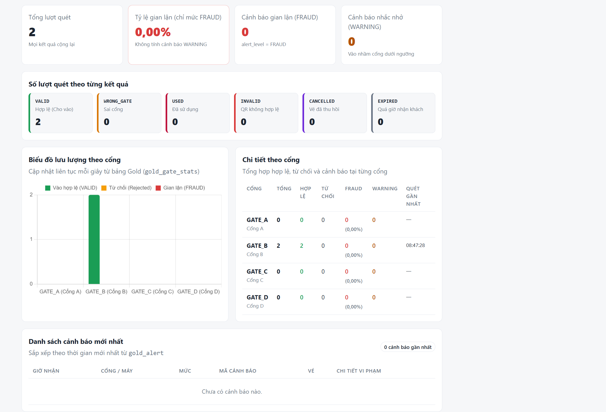
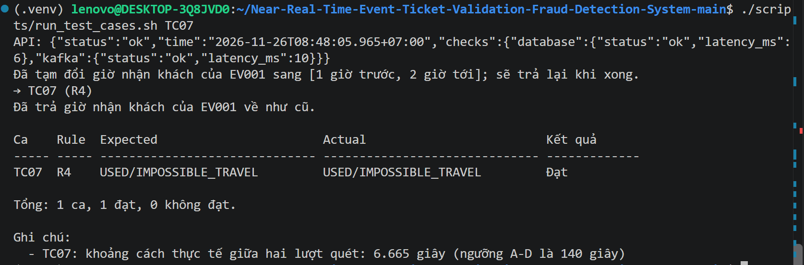
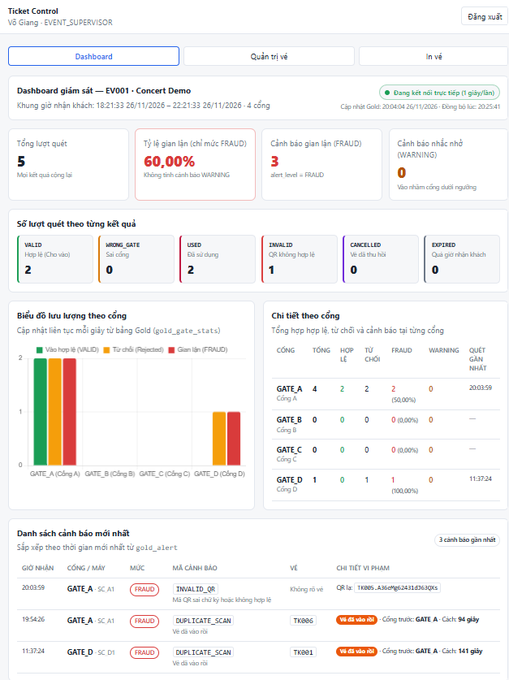
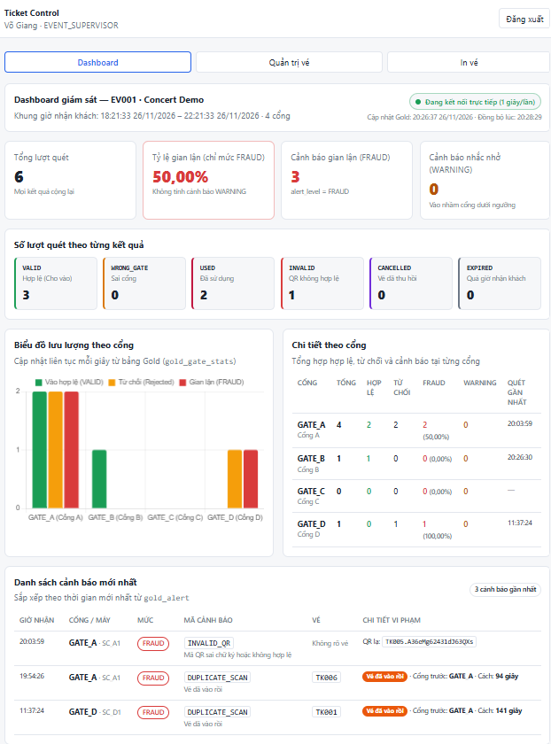

# Báo cáo kiểm thử TC01–TC08

Báo cáo kiểm thử bốn quy tắc gian lận R1–R4 (`Requirements/09_Fraud_Rules.md`) theo 8 ca ở
`Requirements/10_Test_Cases.md`.


## 1. Kết quả tổng hợp

Tổng: 8 ca, **8 đạt**. TC08 không đạt ở lần chạy đầu do lỗi tính giờ của script (không phải lỗi luật R4); sau khi sửa script và chạy lại thì đạt (xem mục 3).

| Ca | Quy tắc | Tình huống | Mong đợi | Thực tế | Đạt/Không |
|---|---|---|---|---|---|
| TC01 | R1 | Vé thật nhưng thuộc sự kiện khác | `INVALID` / `INVALID_QR` | `INVALID` / `INVALID_QR` | Đạt |
| TC02 | R1 | Vé đúng sự kiện, quét ngay sau một vé bị từ chối | `VALID` / không có | `VALID` / không có | Đạt |
| TC03 | R2 | Vé đã bị thu hồi | `CANCELLED` / `REVOKED_TICKET` | `CANCELLED` / `REVOKED_TICKET` | Đạt |
| TC04 | R2 | Vé cùng đợt phát hành nhưng chưa bị thu hồi | `VALID` / không có | `VALID` / không có | Đạt |
| TC05 | R3 | Vé đã vào, quét lại ở cùng cổng | `USED` / `DUPLICATE_SCAN` | `USED` / `DUPLICATE_SCAN` | Đạt (xem ghi chú) |
| TC06 | R3 | Vé khác quét ở cùng cổng, cách 2 giây | `VALID` / không có | `VALID` / không có | Đạt |
| TC07 | R4 | Cùng vé, hai cổng xa nhau, cách 3 giây | `USED` / `IMPOSSIBLE_TRAVEL` | `USED` / `IMPOSSIBLE_TRAVEL` | Đạt |
| TC08 | R4 | Cùng vé, hai cổng xa nhau, cách đúng ngưỡng | `USED` / `DUPLICATE_SCAN` | `USED` / `DUPLICATE_SCAN` (chạy lại sau khi sửa script) | Đạt (xem mục 3) |

## 2. Chi tiết từng ca

### TC01 — R1 bắt được: vé thuộc sự kiện khác
- **Dữ liệu:** `TK005` (thuộc `EV002`, `UNUSED`), quét tại `GATE_A` bằng `SC_A1`.
- **Mong đợi:** `INVALID`, cảnh báo FRAUD `INVALID_QR`, không cho vào, `TK005` giữ `UNUSED`.
- **Thực tế:** `INVALID` / `INVALID_QR`.
- **Kết quả:** Đạt.
- **Dashboard:** 1 lượt quét, `INVALID` = 1, 1 cảnh báo FRAUD tại `GATE_A`.
- **Ảnh terminal:** 
- **Ảnh Dashboard:** 

### TC02 — R1 không báo nhầm
- **Dữ liệu:** `TK005` bị từ chối, ngay sau đó `TK006` (`EV001`) quét tại `GATE_A` bằng cùng máy `SC_A1`.
- **Mong đợi:** `TK006` ra `VALID`, không có cảnh báo, chuyển `UNUSED` → `VALID_ENTRY`.
- **Thực tế:** `VALID` / không có cảnh báo.
- **Kết quả:** Đạt.
- **Dashboard:** 2 lượt quét (`INVALID` = 1, `VALID` = 1); danh sách cảnh báo chỉ có `INVALID_QR` của `TK005`, vé `TK006` quét sau đó không sinh cảnh báo.
- **Ảnh terminal:** 
- **Ảnh Dashboard:** 

### TC03 — R2 bắt được: vé đã bị thu hồi
- **Dữ liệu:** `TK003` (`EV001`, `GATE_C`, `CANCELLED`), quét tại `GATE_C` bằng `SC_C1`.
- **Mong đợi:** `CANCELLED`, cảnh báo FRAUD `REVOKED_TICKET`, không cho vào, `TK003` giữ `CANCELLED`.
- **Thực tế:** `CANCELLED` / `REVOKED_TICKET`.
- **Kết quả:** Đạt.
- **Dashboard:** `CANCELLED` = 1, cảnh báo `REVOKED_TICKET` cho `TK003` tại `GATE_C` / `SC_C1`.
- **Ảnh terminal:** 
- **Ảnh Dashboard:** 

### TC04 — R2 không báo nhầm
- **Dữ liệu:** `TK007` (`EV001`, `GATE_C`, `UNUSED`) quét tại `GATE_C` ngay sau `TK003` bị từ chối.
- **Mong đợi:** `VALID`, không cảnh báo, `UNUSED` → `VALID_ENTRY`.
- **Thực tế:** `VALID` / không có cảnh báo.
- **Kết quả:** Đạt.
- **Dashboard:** 2 lượt quét (`VALID` = 1, `CANCELLED` = 1); chỉ có cảnh báo `REVOKED_TICKET` của `TK003`, `TK007` không bị báo nhầm.
- **Ảnh terminal:** 
- **Ảnh Dashboard:** 

### TC05 — R3 bắt được: vé đã vào, quét lại ở cùng cổng
- **Dữ liệu:** `TK002` đã vào hợp lệ tại `GATE_B`, quét lại tại `GATE_B` bằng `SC_B1`.
- **Mong đợi:** `USED`, cảnh báo FRAUD `DUPLICATE_SCAN`, không cho vào, `VALID_ENTRY` → `FLAGGED_FRAUD`.
- **Thực tế:** `USED` / `DUPLICATE_SCAN`.
- **Kết quả:** Đạt.
- **Ghi chú:** `10_Test_Cases.md` quy định cách 30 phút, nhưng lần chạy này dùng khoảng cách **5 giây**
  (mặc định `TC05_GAP_SECONDS=5`). R3 không phụ thuộc khoảng cách thời gian nên kết luận vẫn có giá trị.
  Chạy đúng 30 phút: `TC05_GAP_SECONDS=1800 ./scripts/run_test_cases.sh TC05`.
- **Dashboard:** `VALID` = 1, `USED` = 1; cảnh báo `DUPLICATE_SCAN` cho `TK002` tại `GATE_B` / `SC_B1`, cổng trước `GATE_B`, cách 9 giây (5 giây chờ cấu hình cộng độ trễ xử lý).
- **Ảnh terminal:** 
- **Ảnh Dashboard:** 

### TC06 — R3 không báo nhầm: vé khác, cùng cổng, cách 2 giây
- **Dữ liệu:** `TK002` vào hợp lệ tại `GATE_B`; 2 giây sau `TK004` (`GATE_B`, `UNUSED`) quét tại `GATE_B`.
- **Mong đợi:** `TK004` ra `VALID`, không cảnh báo, `UNUSED` → `VALID_ENTRY`.
- **Thực tế:** `VALID` / không có cảnh báo.
- **Kết quả:** Đạt.
- **Dashboard:** `VALID` = 2 tại `GATE_B`, tỷ lệ gian lận 0,00%, danh sách cảnh báo trống ("Chưa có cảnh báo nào").
- **Ảnh terminal:** 
- **Ảnh Dashboard:** 

### TC07 — R4 bắt được: cùng vé, hai cổng xa nhau, cách vài giây
- **Dữ liệu:** `TK001` vào hợp lệ tại `GATE_A`; vài giây sau quét tại `GATE_D` bằng `SC_D1`. Ngưỡng A↔D là 140 giây.
- **Mong đợi:** `USED`, cảnh báo FRAUD `IMPOSSIBLE_TRAVEL`, không cho vào, `VALID_ENTRY` → `FLAGGED_FRAUD`.
- **Thực tế:** `USED` / `IMPOSSIBLE_TRAVEL`.
- **Kết quả:** Đạt.
- **Ghi chú:** Script chờ 3 giây giữa hai lượt quét. Ở lần chạy đầu (trước khi sửa script), dòng "khoảng cách thực tế" in sai đơn vị
  (`5909000.000 giây`, nano giây thay vì mili giây), xem mục 3. Ảnh chụp lấy từ lần chạy sau khi sửa: khoảng cách thực tế **6,665 giây**
  (ngưỡng A↔D là 140 giây).
- **Dashboard:** `VALID` = 1 (`GATE_A`), `USED` = 1 (`GATE_D`); cảnh báo `IMPOSSIBLE_TRAVEL` cho `TK001`, nhãn "Hai người dùng chung vé", cổng trước `GATE_A`, cách 7 giây, ngưỡng đi bộ 140 giây.
- **Ảnh terminal:** 
- **Ảnh Dashboard:** 

### TC08 — R4 không báo nhầm: cách đúng bằng ngưỡng
- **Dữ liệu:** `TK001` vào hợp lệ tại `GATE_A`; quét tại `GATE_D` bằng `SC_D1` sau khi đã chờ qua ngưỡng 140 giây.
- **Mong đợi:** `USED`, cảnh báo FRAUD **`DUPLICATE_SCAN`** (không phải `IMPOSSIBLE_TRAVEL`), không cho vào, `VALID_ENTRY` → `FLAGGED_FRAUD`.
- **Thực tế:**
  - Lần chạy 1 (script chưa sửa): `USED` / `IMPOSSIBLE_TRAVEL`, **không đạt**. Nguyên nhân do script, xem mục 3.
  - Lần chạy 2 (đã sửa script, khoảng cách thực tế 141,072 giây): `USED` / `DUPLICATE_SCAN`, **đạt**.
  - Lần chạy 3 (ảnh chụp kèm theo, khoảng cách thực tế 141,472 giây): `USED` / `DUPLICATE_SCAN`, **đạt**.
- **Dashboard:** `VALID` = 1, `USED` = 1; cảnh báo `DUPLICATE_SCAN` cho `TK001` tại `GATE_D` / `SC_D1`, nhãn "Vé đã vào rồi", cổng trước `GATE_A`, cách 141 giây (không phải `IMPOSSIBLE_TRAVEL`).
- **Kết quả:** Đạt.
- **Giới hạn:** qua API không dựng được đúng 140,000 giây (script chờ 140,5 giây), nên ca này kiểm tra "lớn hơn ngưỡng
  một chút" chứ chưa phân biệt `<` với `<=` ở đúng ranh giới. Phần đó do `./scripts/test_boundaries.sh` kiểm tra (xem mục 3).
- **Ảnh terminal:** 
- **Ảnh Dashboard:** 

---

## 3. Ca không đạt ở lần chạy đầu: TC08

**Hiện tượng.** Lần chạy 1, script báo `USED/IMPOSSIBLE_TRAVEL`, mong đợi `USED/DUPLICATE_SCAN`.

**Chẩn đoán.** Dòng "khoảng cách thực tế" script in ra là `4188000.000 giây`, vô lý. Truy vấn dữ liệu thật của `TK001`:

```
GATE_A|VALID|NULL|2026-11-26 08:25:04.115|NULL|NULL
GATE_D|USED|IMPOSSIBLE_TRAVEL|2026-11-26 08:25:08.303|4188|140000
```

Hai lượt quét thực tế chỉ cách nhau **4188 ms** (< 140000 ms), nên `IMPOSSIBLE_TRAVEL` là kết quả **đúng** của R4.
Lỗi nằm ở script, không nằm ở Silver.

**Nguyên nhân gốc.** `run_test_cases.sh` lấy mili giây bằng `date +%s%3N`. Bản `date` trên máy chạy trả về
**nano giây** (9 chữ số lẻ) thay vì mili giây, nên vòng chờ 140 giây thực chất chỉ chờ 0,14 mili giây và lần chạy
lại TC08 chỉ mất 12,7 giây. Con số in ra bị nhân 1.000.000 (4188 ms hiện thành 4188000000).

**Cách sửa.** Đổi mọi chỗ lấy mili giây sang `$(( $(date +%s%N) / 1000000 ))` trong `run_test_cases.sh`; hàm
`epoch_ms` sửa thành `echo $(( $(date -d "$1" +%s%N) / 1000000 ))`. Cùng lỗi này ở `backup_db.sh`, `restore_db.sh`,
`demo_backup_restore.sh` (đo thời gian sao lưu/khôi phục), đã sửa tương tự.

**Chạy lại sau khi sửa.** `./scripts/run_test_cases.sh TC08` mất 2 phút 29 giây (đúng kỳ vọng), khoảng cách thực tế
141,072 giây, kết quả `USED/DUPLICATE_SCAN`: **Đạt**. Chạy thêm lần nữa để chụp ảnh: 141,472 giây, vẫn **Đạt**.

**Ranh giới đúng 140 giây.** Để phân biệt `<` với `<=` cần `./scripts/test_boundaries.sh` (gửi thẳng vào Kafka với
thời gian chính xác; script xóa dữ liệu quét và tắt Spark nên chạy sau cùng).

---

## 4. Kiểm thử bổ sung Role C

**Ngày kiểm thử:** 26/11/2026.

**Môi trường:** Ubuntu WSL, Docker Compose, SQL Server,
Kafka, Spark Streaming và Node.js REST API.

Các kiểm thử dưới đây bổ sung cho TC01–TC08,
không thay thế kết quả kiểm thử các quy tắc R1–R4.

### 4.1. C1 — Thông tin lượt quét trước khi kết quả là USED

**Mục tiêu:** Kiểm tra khả năng cung cấp thông tin
lượt quét trước khi phát hiện vé đã được sử dụng.

**Dữ liệu kiểm thử:**

- Sự kiện: EV001.
- Vé: TK006.
- Cổng: GATE_A.
- Máy quét: SC_A1.

| Thuộc tính | Lượt đầu tiên | Lượt thứ hai |
|---|---|---|
| scan_result | VALID | USED |
| Trạng thái vé trước | UNUSED | VALID_ENTRY |
| Trạng thái vé sau | VALID_ENTRY | FLAGGED_FRAUD |
| previous_scan_gate_id | NULL | GATE_A |
| time_since_previous_scan_ms | NULL | 94155 |
| alert_level | NONE | FRAUD |
| alert_code | NULL | DUPLICATE_SCAN |

Khoảng thời gian giữa hai lượt quét là 94,155 giây.

Thông tin lượt quét trước được ghi nhận tại Silver,
chuyển sang Gold và hiển thị trên Dashboard.

API test cũng xác nhận hai trường này có giá trị
đối với USED và bằng null đối với các kết quả khác.

**Kết quả: Đạt.**

### 4.2. C2 — Dashboard Live

#### 4.2.1. Mục tiêu

- Kiểm tra khả năng cập nhật dữ liệu Dashboard.
- Đối chiếu dữ liệu Silver, Gold và giao diện.
- Kiểm tra quyền truy cập EVENT_SUPERVISOR.
- Kiểm tra nguồn dữ liệu thống kê của Dashboard.

#### 4.2.2. Điều kiện kiểm thử

- API health: OK.
- SQL Server: OK.
- Kafka: OK.
- Spark Bronze và Silver đang hoạt động.
- Sự kiện EV001 đang trong khung giờ nhận khách.
- Dashboard được mở bằng tài khoản supervisor.
- Vé TK002 thuộc EV001, được phân công GATE_B,
  có trạng thái ban đầu UNUSED.

#### 4.2.3. Thao tác kiểm thử

Gửi một lượt quét hợp lệ trực tiếp vào Kafka:

```bash
python3 scripts/send_scans.py TK002@GATE_B@0
```

Theo dõi Spark:

```bash
tail -f logs/spark.log
```

Ca này kiểm tra luồng xử lý Kafka, Spark, Silver,
Gold và Dashboard; không kiểm tra HMAC của REST API.

#### 4.2.4. Kết quả xử lý Spark

```text
[gold] batch 32: đã tính lại Gold (0.02s)

[silver] batch 32: 1 lượt -> Silver (VALID 1);
1 vé đổi trạng thái; 0 đã có (bỏ qua);
0 -> DLQ; 3.52s

[batch 32] 1 bản tin hợp lệ -> Bronze,
0 bản tin hỏng -> DLQ
```

Kết quả của TK002:

| Thuộc tính | Giá trị |
|---|---|
| event_id | EV001 |
| ticket_id | TK002 |
| gate_id | GATE_B |
| scanner_id | SC_B1 |
| scan_result | VALID |
| alert_level | NONE |
| alert_code | NULL |
| ticket_status | VALID_ENTRY |

#### 4.2.5. So sánh Dashboard trước và sau kiểm thử

| Chỉ số | Trước | Mong đợi | Thực tế | Kết quả |
|---|---:|---:|---:|---|
| Tổng lượt quét | 5 | 6 | 6 | Đạt |
| VALID | 2 | 3 | 3 | Đạt |
| USED | 2 | 2 | 2 | Đạt |
| INVALID | 1 | 1 | 1 | Đạt |
| FRAUD | 3 | 3 | 3 | Đạt |
| WARNING | 0 | 0 | 0 | Đạt |
| Tỷ lệ gian lận | 60% | 50% | 50% | Đạt |
| Tổng lượt GATE_B | 0 | 1 | 1 | Đạt |
| VALID tại GATE_B | 0 | 1 | 1 | Đạt |

**Dashboard trước kiểm thử:**



**Dashboard sau kiểm thử:**



#### 4.2.6. Đối chiếu Silver, Gold và Dashboard

| Chỉ số | Silver | Gold | Dashboard |
|---|---:|---:|---:|
| Tổng lượt quét | 6 | 6 | 6 |
| VALID | 3 | 3 | 3 |
| USED | 2 | 2 | 2 |
| INVALID | 1 | 1 | 1 |
| CANCELLED | 0 | 0 | 0 |
| EXPIRED | 0 | 0 | 0 |
| WRONG_GATE | 0 | 0 | 0 |
| FRAUD | 3 | 3 | 3 |
| WARNING | 0 | 0 | 0 |
| Tỷ lệ gian lận | 50% | 50% | 50% |

Thống kê theo cổng:

| Cổng | Tổng lượt | Hợp lệ | Từ chối | FRAUD |
|---|---:|---:|---:|---:|
| GATE_A | 4 | 2 | 2 | 2 |
| GATE_B | 1 | 1 | 0 | 0 |
| GATE_C | 0 | 0 | 0 | 0 |
| GATE_D | 1 | 0 | 1 | 1 |
| Tổng | 6 | 3 | 3 | 3 |

GATE_C chưa phát sinh lượt quét nên chưa có
bản ghi tương ứng trong GOLD_GATE_STATS.
API sử dụng LEFT JOIN và ISNULL để vẫn hiển thị
cổng này với các chỉ số bằng 0.

#### 4.2.7. Kiểm tra mã nguồn và phân quyền

Endpoint:

```text
GET /api/dashboard/live
```

Middleware:

```javascript
authenticate,
requireRole('EVENT_SUPERVISOR')
```

Nguồn dữ liệu:

| Thành phần | Bảng dữ liệu |
|---|---|
| Thông tin sự kiện | EVENT |
| Danh sách cổng | GATE, EVENT_GATE |
| Thống kê tổng quan | GOLD_EVENT_STATS |
| Thống kê theo cổng | GOLD_GATE_STATS |
| Cảnh báo | GOLD_ALERT |

API không truy vấn trực tiếp SCAN_EVENT hoặc
FRAUD_ALERT để tính toán số liệu Dashboard.

Frontend cấu hình:

```javascript
var POLL_INTERVAL_MS = 1000;
```

Cơ chế polling sử dụng setTimeout và gửi yêu cầu
đến endpoint /api/dashboard/live.

API trả header Cache-Control: no-store.

| Kiểm thử quyền | Mong đợi | Thực tế |
|---|---|---|
| Không có JWT | HTTP 401 | HTTP 401 |
| JWT của GATE_OPERATOR | HTTP 403 | HTTP 403 |
| JWT của EVENT_SUPERVISOR | HTTP 200 | HTTP 200 |

#### 4.2.8. Thời gian cập nhật Gold

- scanned_at: 2026-11-26 20:26:30.253.
- updated_at: 2026-11-26 20:26:37.017.
- Khoảng thời gian: 6764 ms, tương đương 6,764 giây.
- Thời gian xử lý Silver được ghi trong log: 3,52 giây.
- Thời gian tính lại Gold: 0,02 giây.

Spark ghi nhận cảnh báo batch vượt trigger interval
1000 ms. Tuy nhiên, batch vẫn xử lý thành công,
không phát sinh bản tin DLQ.

Khoảng nghỉ polling 1 giây không đồng nghĩa
độ trễ toàn bộ pipeline luôn dưới 1 giây.

Giá trị 6,764 giây là khoảng thời gian từ scanned_at
đến updated_at của Gold, không phải độ trễ end-to-end
đến trình duyệt.

#### 4.2.9. Kết luận C2

- Đối chiếu dữ liệu Silver, Gold và Dashboard: Đạt.
- Thống kê theo cổng: Đạt.
- Phân quyền Dashboard: Đạt.
- Nguồn dữ liệu thống kê Gold: Đạt.
- Cấu hình polling 1000 ms: Đạt.
- Xác nhận thao tác cập nhật không tải lại trang:
  cần xác nhận của người trực tiếp thực hiện kiểm thử.

### 4.3. C3 — Database Least Privilege

API và Spark sử dụng hai tài khoản chuyên biệt:

- api_user.
- spark_user.

| Kiểm thử | Kết quả |
|---|---|
| Kiểm tra quyền api_user | 32/32 đạt |
| Kiểm tra quyền spark_user | 31/31 đạt |
| Tổng số quyền được kiểm tra | 63/63 đạt |
| Mô phỏng khởi tạo tài khoản độc lập | 8/8 đạt |
| Đăng nhập bằng api_user | Thành công |
| Đăng nhập bằng spark_user | Thành công |
| Kiểm tra SQL Session thực tế | Đạt |
| API INSERT trái phép vào scan_event | SQL Server error 229 |
| Spark ghi Silver | Thành công |
| Spark cập nhật Gold qua stored procedure | Thành công |

Kiểm thử 8/8 sử dụng sqlcmd mô phỏng để kiểm tra
luồng điều kiện của entrypoint.sh, không phải
tám lần triển khai SQL Server mới.


**Kết quả: Đạt đối với các trường hợp đã kiểm thử.**

### 4.4. C4 — Kiểm thử bảo mật

| Cơ chế | Kiểm thử | Kết quả |
|---|---|---|
| HMAC-SHA256 | Sửa chữ ký QR | INVALID_QR |
| JWT | Truy cập không có token | HTTP 401 |
| RBAC | Operator truy cập Dashboard | HTTP 403 |
| Bcrypt | Kiểm tra password_hash | Cost factor 10 |
| Least Privilege | INSERT trái phép | Error 229 |
| Secret management | Kiểm tra docker/.env | Không được Git theo dõi |

QR giả được gửi qua REST API với mã vé TK005
và chữ ký HMAC đã bị thay đổi.

Kết quả:

- scan_result = INVALID.
- entry = DENY.
- alert_level = FRAUD.
- alert_code = INVALID_QR.
- ticket_id trong Silver = NULL.
- decode_error = 1.
- Vé TK005 vẫn có trạng thái UNUSED.
- Gold ghi nhận cảnh báo INVALID_QR.

Chi tiết và ảnh minh chứng được trình bày tại
[Security Documentation](security.md).

**Kết quả: Đạt đối với các trường hợp đã kiểm thử.**

### 4.5. Tổng hợp kiểm thử Role C

| Hạng mục | Kết quả |
|---|---|
| Unit test và API test | 30/30 đạt |
| Database permission test | 63/63 đạt |
| Mô phỏng khởi tạo độc lập | 8/8 đạt |
| Liên kết ảnh security.md | 9/9 hợp lệ |
| Chỉ số Dashboard trước và sau | 9/9 khớp |
| Đối chiếu Silver, Gold và Dashboard | 10/10 khớp |
| Git diff check | Đạt |

Các nhóm kiểm thử trên có phạm vi khác nhau,
không cộng gộp thành một tỷ lệ kiểm thử duy nhất.

Kết quả phản ánh môi trường phát triển và các
tình huống đã thực hiện, không phải chứng nhận
bảo mật hoặc hiệu năng production.
